# Customered_Ubuntu

**Stock Ubuntu 26.04 Desktop, finished.** One command turns a fresh Ubuntu install into a polished,
macOS-inspired GNOME desktop: Mission Control-style workspaces and Split View, Spotlight-style Quick
Answers, a refined Chinese pinyin input method, an emoji picker, a built-in desktop stability log,
and the everyday apps and developer tools already installed. After that it **keeps itself up to
date**: signed releases are installed silently in the background, and you get a notification when
it is done.

<p align="center">
  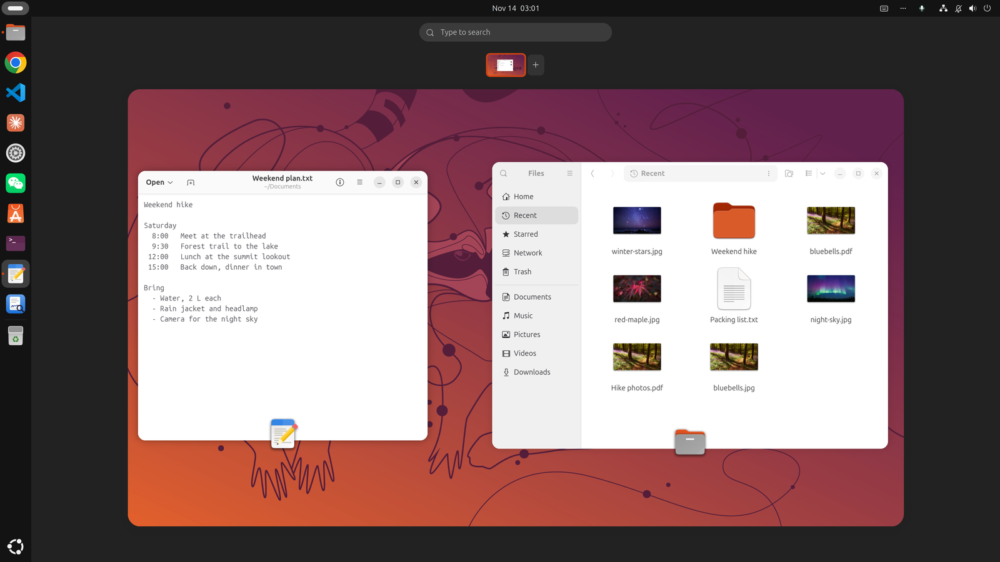
</p>

<p align="center">
  <a href="#install">Install</a> ·
  <a href="#what-you-get">What you get</a> ·
  <a href="#automatic-updates">Automatic updates</a> ·
  <a href="#stopping-updates--uninstalling">Uninstall</a> ·
  <a href="docs/CHANGELOG.md">Changelog</a> ·
  <a href="docs/FEATURES-INVENTORY.md">Full feature inventory</a>
</p>

### Highlights

- **[Quick Answers](docs/features/quick-answers.md)**: press `Super` and type `70 mph`, `100 usd`,
  `time in tokyo`, `weather in paris`, `define serendipity` or a flight number, and the answer
  appears right in the overview search.
- **[Workspaces like Mission Control](docs/features/workspaces.md)**: drag to reorder, "+" and "×",
  maximized windows get their own space, and **Split View** puts two apps side by side.
- **[Chinese input that looks native](docs/features/pinyin-input.md)**: fcitx5 pinyin with macOS-style
  light and dark candidate bars, flicker-free cloud pinyin, and correct placement in Chrome, Electron
  apps and WeChat.
- **[Emoji picker](docs/features/emoji-picker.md)** on `Super+.` that works in every app, with
  English and Chinese search.
- **[Stability Guard](docs/features/stability-guard.md)**: a local black-box log of docking, lock,
  suspend and login events and the errors that follow them, with a one-command report.
- **Signed, silent updates**: only releases signed with the maintainer's key are ever run, and your
  own settings are never overwritten.

## Install

1. Open a terminal (`Ctrl+Alt+T`).
2. Paste this command, press Enter and type your login password:

   ```
   wget -qO- https://raw.githubusercontent.com/Zdong104/Customered_Ubuntu/main/bootstrap.sh | sudo bash
   ```

3. When it says the installation is complete, log out and back in once (and restart once more if it
   says a restart is needed).

The first install takes about 30–60 minutes and needs a network connection; you can keep using the
computer meanwhile. If it gets interrupted, run the same command again: it continues where it
stopped. Software that is already installed (Chrome, VS Code, WeChat, Zoom, Miniconda, TinyTeX, snap
apps, ...) is reported as "already installed, skipped" and not downloaded again. If a single download
fails (for example a vendor's download URL is temporarily unavailable), the installation does not
stop: the failed items are listed at the end and retried automatically in the background.

Optional: end the command with `| sudo bash -s -- --reset-desktop` to reset **your own** desktop
appearance to this setup's defaults right away (only the options listed under
[Desktop defaults](#desktop-defaults)). Without this flag, every setting you have already changed is
kept.

Before installing, it checks for Ubuntu 26.04, x86_64, a GNOME desktop, at least 25 GB free on the
system disk, and that GitHub is reachable. If any check fails, it explains why and changes nothing.
A battery below 30% only produces a reminder to plug in.

New machines can also be set up from a bootable installer image built from the same payload; see
[docs/ISO.md](docs/ISO.md).

## What you get

Everything below is enabled for you once. If you switch an extension off in the Extensions app, it
stays off, and settings you change yourself always win over these defaults. GNOME Shell extensions
take effect after you log out and back in.

**Tip:** hold `Super` for a moment to see a [cheatsheet of every shortcut](docs/features/shortcut-cheatsheet.md).

### Search: Quick Answers

Press `Super` and type. Stock GNOME search finds apps, files and settings; Quick Answers adds
instant answers on top, and `Enter` copies the result (or opens the source page for a lookup).
Units, time zones, date math, colours and number bases are calculated on your computer; currency,
weather and definitions come from free public services, sent straight from your computer. A live
flight-status card needs a free AeroDataBox key of your own, and the search walks you through
getting one; without it, a flight number gives tracking links.
[Every answer type, settings and privacy →](docs/features/quick-answers.md)

<table>
  <tr>
    <td>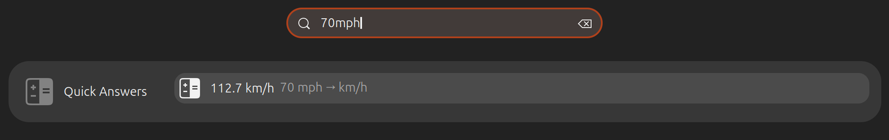</td>
    <td>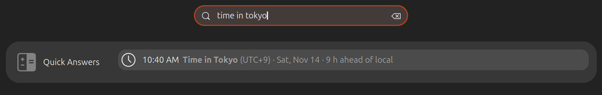</td>
    <td>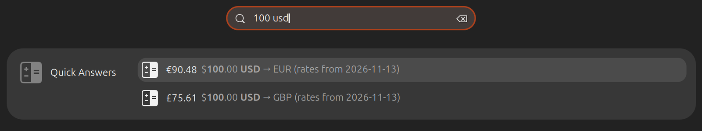</td>
  </tr>
  <tr>
    <td align="center">Units: <code>70mph</code></td>
    <td align="center">Time zones: <code>time in tokyo</code></td>
    <td align="center">Currency: <code>100 usd</code></td>
  </tr>
  <tr>
    <td>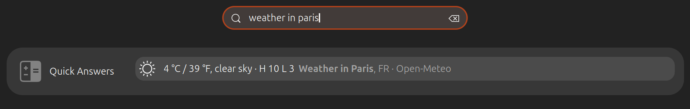</td>
    <td>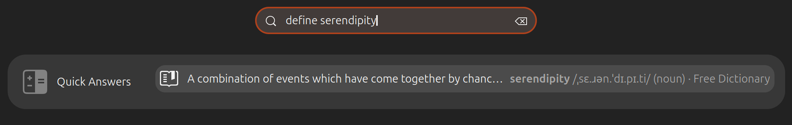</td>
    <td>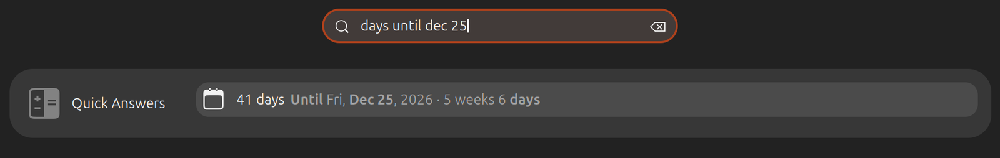</td>
  </tr>
  <tr>
    <td align="center">Weather: <code>weather in paris</code></td>
    <td align="center">Definitions: <code>define serendipity</code></td>
    <td align="center">Date math: <code>days until dec 25</code></td>
  </tr>
  <tr>
    <td>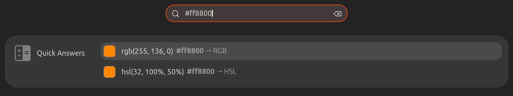</td>
    <td>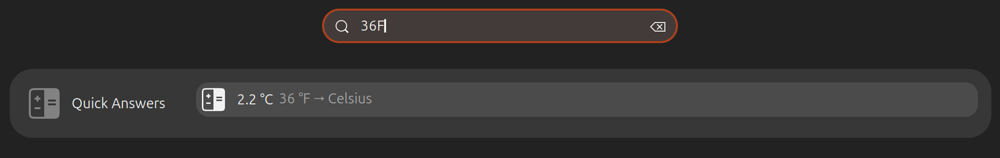</td>
    <td>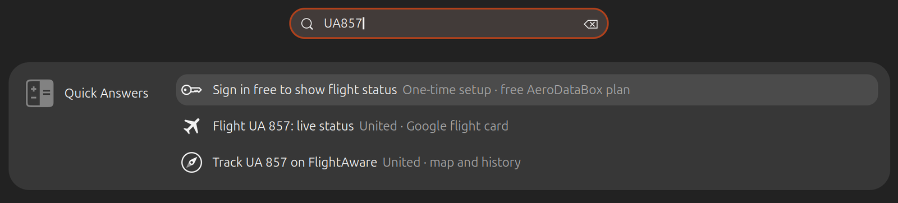</td>
  </tr>
  <tr>
    <td align="center">Colours: <code>#ff8800</code></td>
    <td align="center">Temperature: <code>36F</code></td>
    <td align="center">Flights: <code>UA857</code></td>
  </tr>
</table>

### Input and typing

| Feature | What's different from stock Ubuntu | How to use |
|---|---|---|
| [**fcitx5 pinyin**](docs/features/pinyin-input.md) | fcitx5 replaces IBus as the input method for every user and starts at login. Candidate bars use macOS-style light and dark themes; cloud pinyin adds a suggestion without making the bar blink. | `Ctrl+Space` switches between English and pinyin |
| [**Correct candidate placement**](docs/features/pinyin-input.md#candidate-position-in-chrome-claude-and-electron-apps) | The candidate bar appears at the text cursor in Chrome, Chrome web apps, Claude and other Electron apps, and on every monitor, instead of drifting to a screen corner. | Automatic |
| [**WeChat on the system input method**](docs/features/pinyin-input.md#wechat) | WeChat uses the same fcitx5 candidate bar as every other app instead of its own blinking popup, and still sends desktop notifications. | Start WeChat from the dock or app grid |
| [**Emoji Picker**](docs/features/emoji-picker.md) | A searchable emoji grid that inserts into any app, including Chrome and Electron apps where GTK's chooser is not available. Search works with English and Chinese keywords; recently used emoji come first. | `Super+.` or `Ctrl+Super+Space`; `1`–`9` picks from the highlighted row |
| **Mac-style line navigation** | `Ctrl+←` / `Ctrl+→` jump to the start or end of the line, and `Ctrl+Shift+←` / `Ctrl+Shift+→` select to it. `Ctrl+Home` / `Ctrl+End` are unchanged. | Works in every app (replaces the stock word jump) |
| [**Vocalinux voice typing**](docs/features/pinyin-input.md#voice-typing-vocalinux) | Local, offline speech-to-text (whisper.cpp with Vulkan GPU acceleration and CPU fallback), started in the background after login. Chinese text is pasted reliably, and the touchpad's "disable while typing" keeps working. | Hold `Left Alt` while you speak |

<table>
  <tr>
    <td>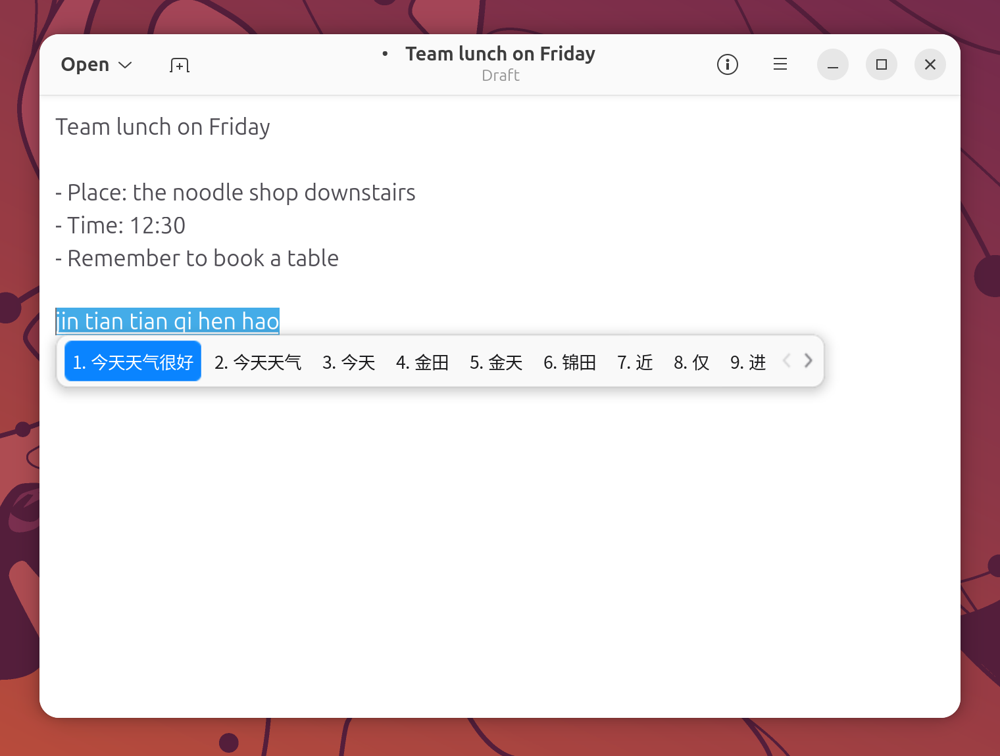</td>
    <td>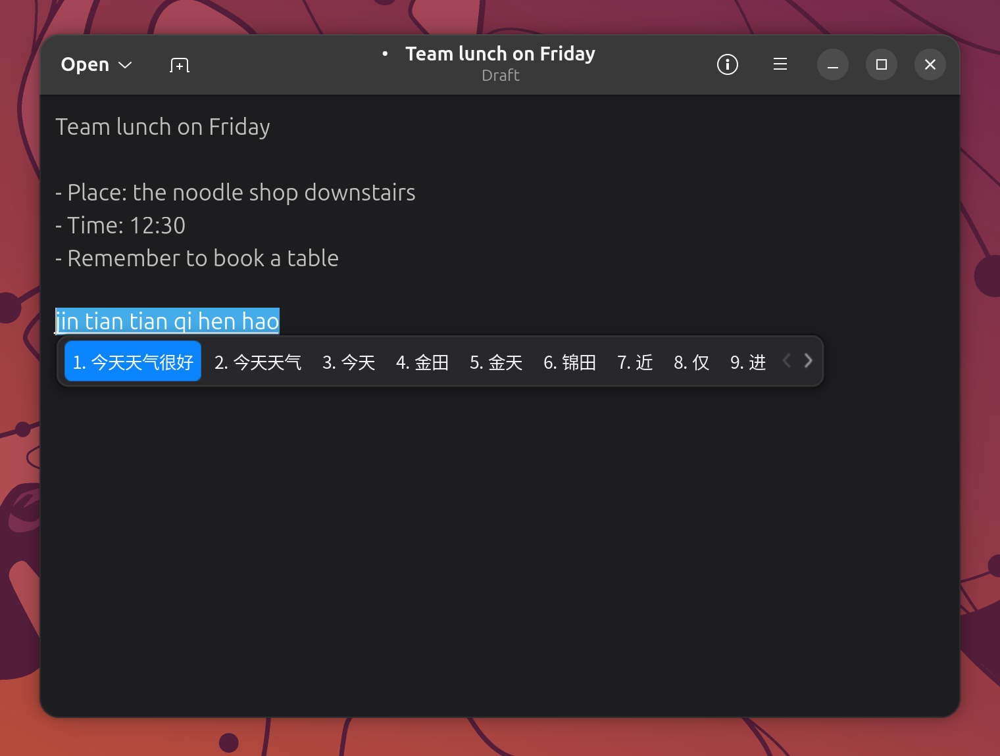</td>
  </tr>
  <tr>
    <td align="center">Pinyin, light style</td>
    <td align="center">Pinyin, dark style</td>
  </tr>
  <tr>
    <td colspan="2" align="center">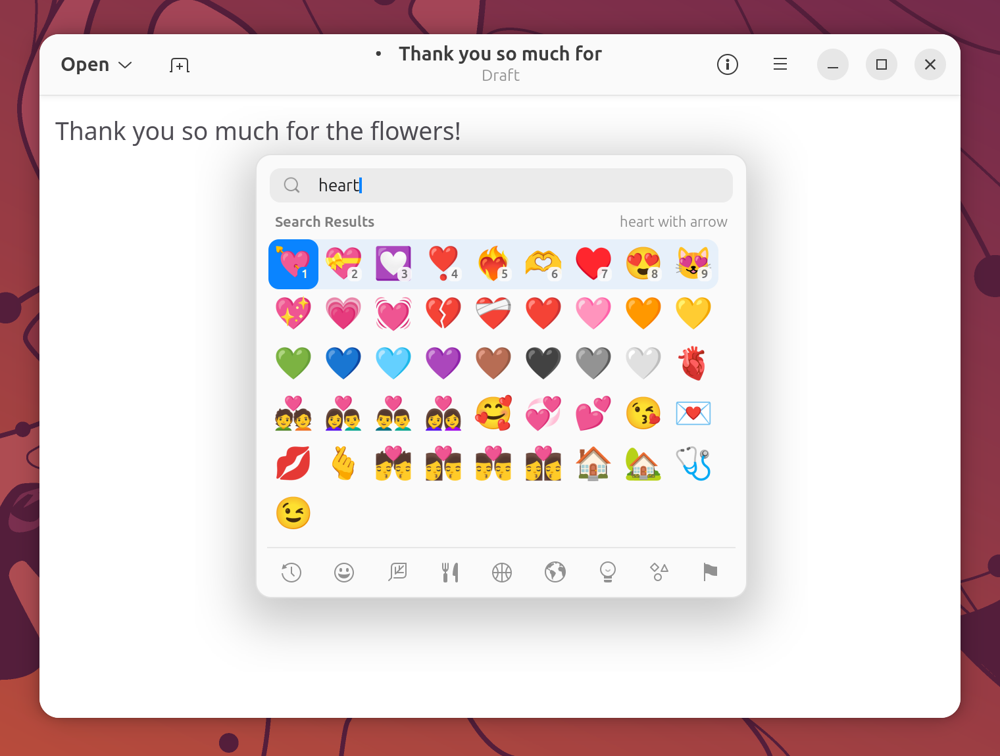<br>Emoji Picker: search, then press <code>1</code>–<code>9</code></td>
  </tr>
</table>

### Windows and workspaces

| Feature | What's different from stock Ubuntu | How to use |
|---|---|---|
| [**Workspace Manage**](docs/features/workspaces.md#workspace-manage) | Manage workspaces like macOS Mission Control: drag thumbnails to reorder them, "+" adds one, and the "×" on a thumbnail removes it (its windows move to the neighbour). Works on every monitor, and thumbnails can be dragged between monitors. | Open the overview (`Super`) |
| [**Split View**](docs/features/workspaces.md#split-view) | Two apps share one full-screen space, half each. | In the overview, drag a window onto the left or right half of a full-screen workspace thumbnail |
| [**Maximize to Own Workspace**](docs/features/workspaces.md#maximize-to-own-workspace) | A maximized or full-screen window gets a workspace of its own, and returns when restored, as on macOS. | Maximize (`Super+↑`), restore (`Super+↓`) |
| [**Workspace Islands**](docs/features/workspaces.md#workspace-islands) | External monitors get their own independent workspaces (stock GNOME has workspaces on the primary screen only). | `Super+Alt+←/→` on an external monitor |
| [**Dock Pull Window**](docs/features/workspaces.md#dock-pull-window) | Clicking a dock icon brings a normal window to your current workspace instead of yanking you to the workspace it is on. Maximized and split windows still switch you to their space. | Dock click or `Super+1`…`9` |
| [**Title Bar Below Top Bar**](docs/features/workspaces.md#title-bar-below-top-bar) | A window's title bar is never hidden behind the top bar (common with Chrome web apps). | Automatic |
| [**Hide Minimized**](docs/features/workspaces.md#hide-minimized) | Minimized windows leave the overview and `Alt+Tab`, like on macOS. | Restore from the dock or `Super+Tab` |
| [**No Sticky Windows**](docs/features/workspaces.md#no-sticky-windows) | Claude, Chrome and Electron windows stay on one workspace instead of showing on every workspace. | Automatic |
| [**Thumbnail Wallpaper**](docs/features/workspaces.md#thumbnail-wallpaper) | Workspace thumbnails show your wallpaper instead of plain grey. | Automatic |
| [**Raise Browser**](docs/features/workspaces.md#raise-browser) | Clicking a link in WeChat and similar apps brings Chrome to the front. | Automatic |

<table>
  <tr>
    <td>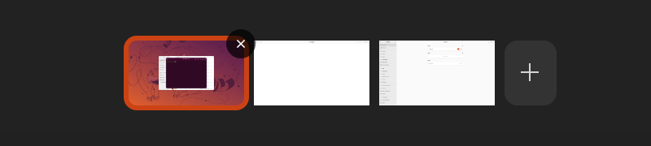</td>
    <td>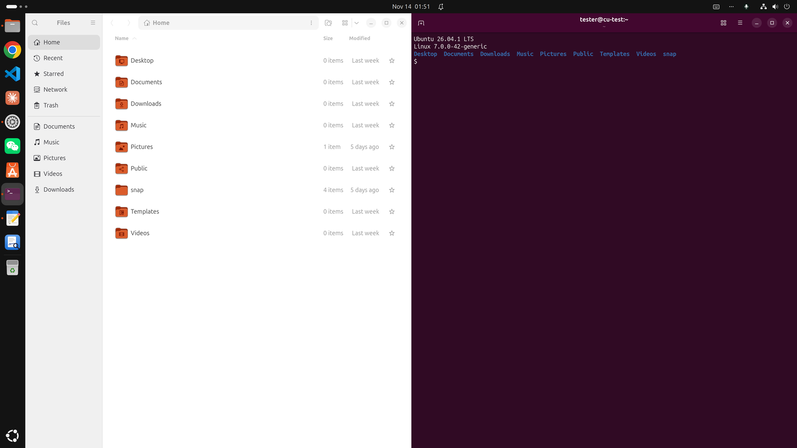</td>
    <td>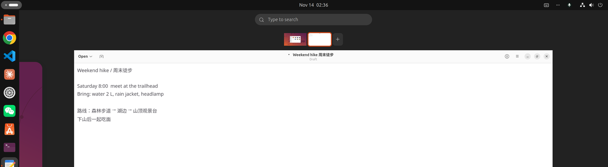</td>
  </tr>
  <tr>
    <td align="center">Workspace Manage: "+" and "×"</td>
    <td align="center">Split View</td>
    <td align="center">Maximize to Own Workspace</td>
  </tr>
</table>

### Files

| Feature | What's different from stock Ubuntu | How to use |
|---|---|---|
| [**Recent folders**](docs/features/files.md#recent-folders) | Folders you used recently appear in Files' Recent view (GNOME lists only files). | Open Recent in the Files sidebar |
| [**Thumbnails in Recent**](docs/features/files.md#thumbnails-in-recent) | Images and documents in Recent show previews instead of generic icons. | Automatic |
| [**Real paths when copying from Recent**](docs/features/files.md#real-paths-when-copying-from-recent) | Copying an item in Recent and pasting it into a terminal, chat or editor gives the file's real path, not an internal `recent:///` address. | `Ctrl+C` in Recent |
| [**Combine images into a PDF**](docs/features/files.md#convert-or-combine-images-into-a-pdf) | Turn one image, or several in file-name order, into a single PDF. | Right-click selected images |
| [**Send with LocalSend**](docs/features/files.md#send-with-localsend) | Send files or folders to nearby phones and computers, similar to AirDrop. LocalSend runs in the tray after login. | Right-click → Send with LocalSend |

Both menu items now also work in the Recent view. Files also defaults to list view, folders first,
zip compression and a path bar in file choosers.

<table>
  <tr>
    <td>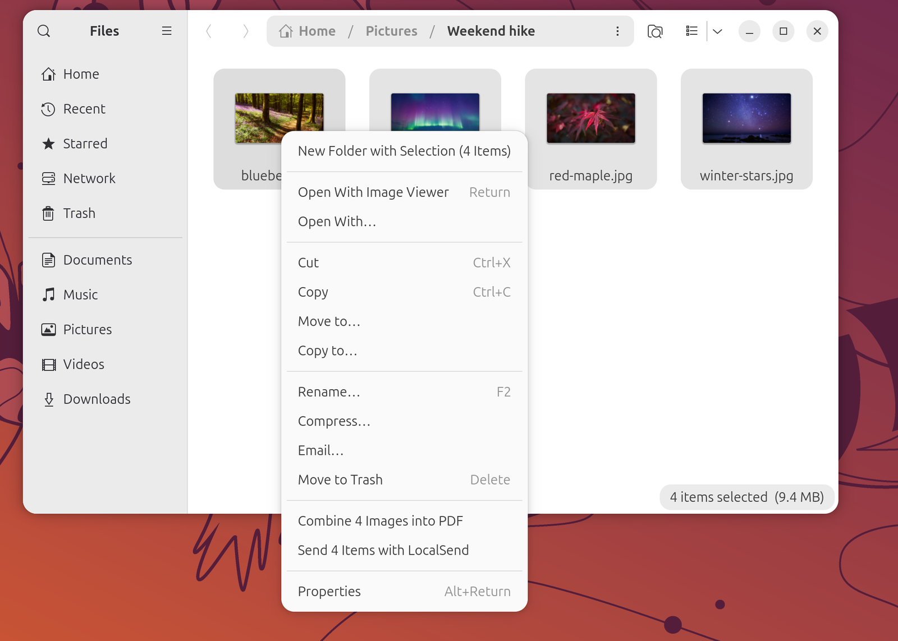</td>
    <td>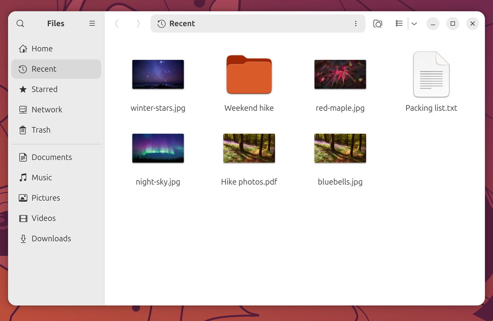</td>
  </tr>
  <tr>
    <td align="center">PDF and LocalSend in the context menu</td>
    <td align="center">Recent with folders and thumbnails</td>
  </tr>
</table>

### Notifications

| Feature | What's different from stock Ubuntu | How to use |
|---|---|---|
| [**5-second banners**](docs/features/notifications.md#notification-banners) | Every banner, critical ones included, closes after at most 5 seconds, and a newer banner replaces it straight away instead of queueing. In full screen, only the app you are looking at has its banners held back. | Automatic; `Super+V` opens the notification list |
| [**Do Not Disturb means it**](docs/features/notifications.md#dnd-hides-critical) | With Do Not Disturb on, even "critical" banners (Chrome sends those for web Teams messages) stay hidden. They still go to the notification list. | Toggle Do Not Disturb in the notification list |
| **Tidy badges and web-app notifications** | An app's notifications and its dock badge clear once you have looked at the app (WeChat's never did). Notifications from Chrome web apps such as Teams, Outlook and Google Chat are filed under the web app instead of "Google Chrome". | Automatic |

<table>
  <tr>
    <td>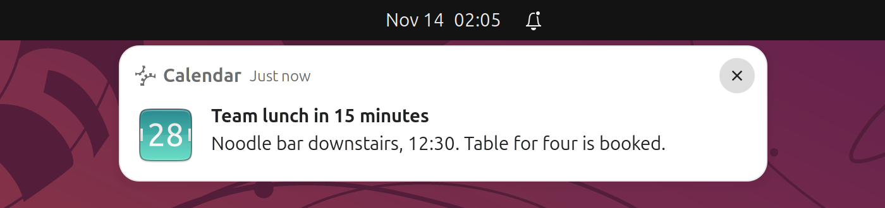</td>
    <td>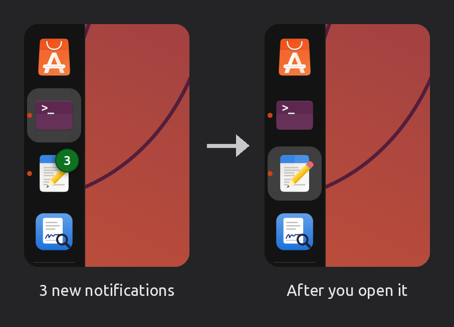</td>
  </tr>
  <tr>
    <td align="center">A banner, gone after 5 seconds</td>
    <td align="center">Dock badges that clear when you look</td>
  </tr>
</table>

### Office: ONLYOFFICE and ProCharts

[ONLYOFFICE Desktop Editors](https://www.onlyoffice.com/desktop.aspx) opens Word, Excel and
PowerPoint files and updates with the system. It comes with the **ProCharts** presentation plugin:
waterfall, Mekko, Gantt, pipeline, butterfly and other business charts, plus elements such as Harvey
balls, gauges and process flows, all built from native shapes and editable from a side panel. In a presentation, open **Insert → ProCharts**.
[Chart types and how to edit them →](docs/features/procharts.md)

<table>
  <tr>
    <td>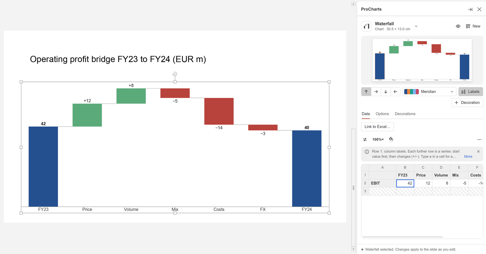</td>
    <td>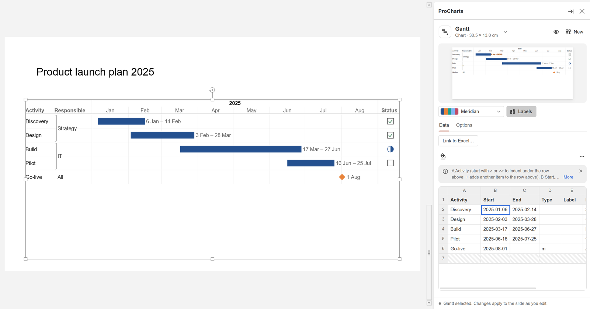</td>
  </tr>
  <tr>
    <td align="center">Waterfall</td>
    <td align="center">Gantt</td>
  </tr>
</table>

### Reliability: Stability Guard

Desktop glitches such as a black monitor after docking, extensions that vanish after a logout, or a
shell restart leave scattered traces that are hard to find later. Stability Guard keeps a **local
black-box log** of lock, dock, monitor, suspend and login events together with the errors that
follow them, and `desktop-blackbox-report` turns it into a readable timeline. A separate recorder
notices when GNOME Shell had to be force-killed at logout and tells you if that switched your
extensions off. The extensions also carry built-in guards against the crashes and lock-screen and
monitor-change problems this logging turned up. Everything stays on your computer; nothing is
uploaded. [How to read the report →](docs/features/stability-guard.md)

```
desktop-blackbox-report              # what happened in the last 7 days
desktop-blackbox-report --since 12h  # just today
```

<p align="center">
  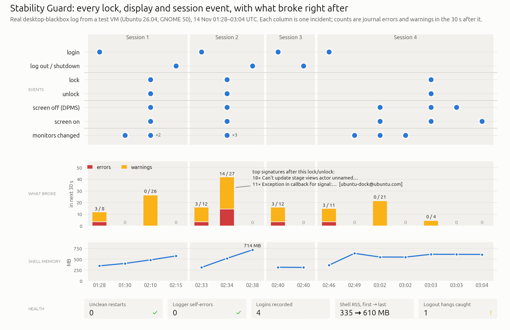
</p>

### Shortcut cheatsheet

Hold `Super` for a moment and an overlay lists the shortcuts of stock Ubuntu and of this setup;
release `Super` to close it. You can add your own entries.
[Details →](docs/features/shortcut-cheatsheet.md)

<p align="center">
  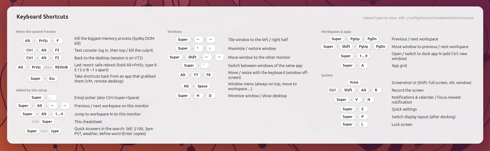
</p>

### Apps

| Category | Contents |
|---|---|
| Browsers / AI | Google Chrome, Firefox (Mozilla's official .deb, not the snap), Claude desktop, ChatGPT desktop |
| Communication | WeChat, Zoom, Slack, Discord |
| Office / editing | ONLYOFFICE Desktop Editors (with ProCharts), VS Code, img2pdf, Showtime video player, Remmina remote desktop |
| Other snaps | Cheese camera, nvtop (GPU monitor), astral-uv, View, LocalSend |
| Virtualization / containers | QEMU + libvirt + virt-manager (with UEFI/OVMF and swtpm TPM emulation), Docker |
| Media / drivers | Common codecs (ubuntu-restricted-addons), Intel hardware video decoding |
| Tools | tmux, 7zip, zstd, clipboard tools and more |

**Uninstall from the menu.** Right-click (or press and hold) an app in the app grid or the dock and
choose **Uninstall**. It works for debs, snaps, Flatpaks and your own launchers, asks for your
password through the standard system prompt, and refuses any removal that would take part of the
system with it. Apps that are part of a minimal Ubuntu install get no such item.

<p align="center">
  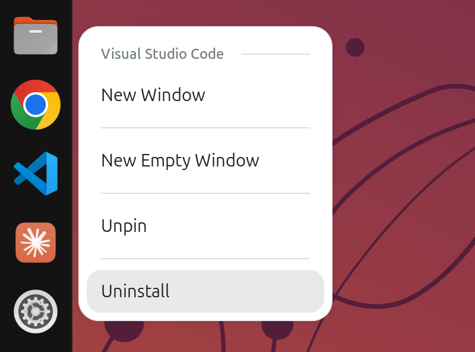
  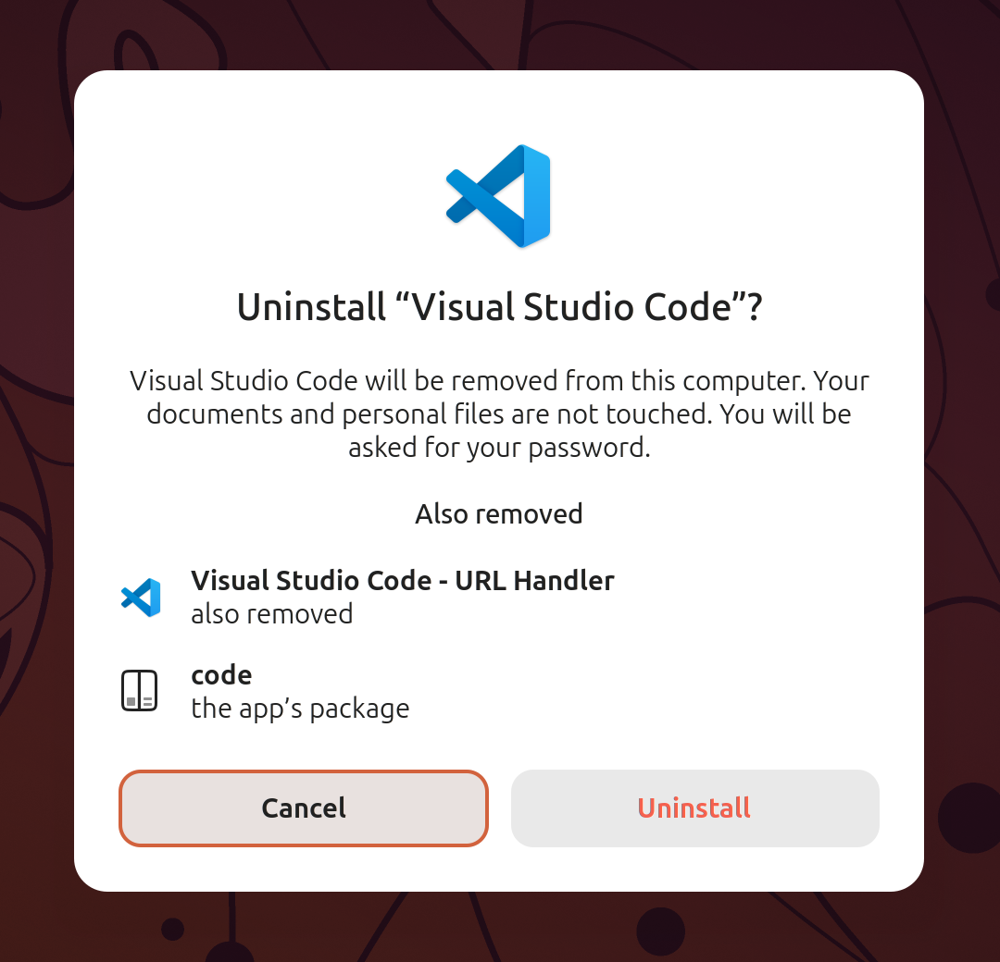
</p>

### Development environment

- Toolchain: build-essential, cmake, autotools, pkg-config, git, Node.js + npm, Python 3
  (pip/venv/dev), Java (OpenJDK 25), Vulkan tools and a set of common development headers.
- Command-line AI tools: **Claude Code** and **Codex** (global npm, under `/usr/local`).
- **Miniconda** in `/opt/miniconda3`, available to all users and not auto-activated (run
  `conda activate` when needed); your own environments live in `~/.conda`.
- **TinyTeX** (including XeLaTeX, so Chinese documents compile out of the box), commands in
  `/usr/local/bin`.
- The **uv** tool `harbor`.

### Desktop defaults

These are only **defaults**: settings you change yourself always win, and automatic updates never
overwrite them.

- Dark style (Yaru-dark), battery percentage shown, hot corner on, wallpaper "Twin brothers".
- A single workspace to start with (add more with Workspace Manage); workspaces switch on the primary
  screen only; `Alt+Tab` shows windows from all workspaces.
- Dock icon size 42; favorites: Files, Chrome, VS Code, Claude, Settings, WeChat, App Center,
  Terminal, Text Editor, View.
- Tiling Assistant: orange focus hint, and the tiling popup shows windows from all workspaces.
- Tap to click, two-finger scrolling, touchpad disabled for 1.5 s while typing; slightly faster
  mouse and touchpad speed.
- Power: no automatic screen blanking, dimming or suspend, on AC or battery; power-saver mode is not
  forced at low battery.
- Eye-care reminder: a 5-minute break every 30 minutes. Night Light colour temperature 3330 K (whether
  it is on is up to you).
- Desktop icons: press `Space` on a desktop file for a quick preview; icons appear on the primary
  screen only.
- Error reports are not sent automatically.

### Hardware and recovery

- **NVIDIA GPUs**: if no driver is installed yet, the driver Ubuntu recommends is installed
  automatically (an existing driver is left alone).
- **ThinkPad P1 Gen 8** (detected by model; other computers are unaffected): fixes for the internal
  display going black or flickering (PSR disabled, panel re-lit automatically, `Super+Shift+D` for a
  manual fix), Thunderbolt 5 external displays, NVIDIA PRIME on-demand mode, and automatic restart of
  PipeWire audio after a crash.
- **Freeze recovery**: Magic SysRq is enabled (`kernel.sysrq = 240`). When the desktop is completely
  frozen, hold `Alt+PrtSc` and press `E I S U B` in turn to reboot safely without holding the power
  button.
- **Groups**: so that voice input and virtualization work out of the box, all users join the `input`
  group; administrators (sudo group) also join `adm kvm libvirt docker`. Note that the `docker` group
  is equivalent to root, and the `input` group can read keyboard input.

The [feature inventory](docs/FEATURES-INVENTORY.md) lists every feature with its source location.

## Automatic updates

- A background check runs 15 minutes after every boot and once a day (randomly delayed by up to 2
  hours). It is skipped on battery below 30% or on a metered connection (phone hotspot).
- It runs at low priority (4 GB memory cap) without disturbing normal use, and only installs what is
  missing or changed; a typical update takes a few seconds to a few minutes.
- When it finishes it shows a notification such as "Desktop configuration updated to vX". If GNOME
  extensions or desktop settings changed, the notification asks you to log out and back in (under
  Wayland, extensions are loaded only at login). Failed items are retried automatically later.
- It only **adds or updates** things: packages are never removed automatically (unless explicitly
  listed in `payload/remove.txt`). Configuration files this setup no longer ships are deleted, and if
  a file of the same name existed on your machine before, your original version is restored.
- System upgrades themselves (kernel, packages) remain the job of Ubuntu's Software Updater.

Useful commands:

```
preload-update --status          # current version, last update result, next check time
sudo preload-update --now        # check and update right now
sudo preload-update --check      # only check whether a new release exists
preload-update --rollback-info   # update history, and how to undo
```

### Security

The updater runs code from this repository as root, so it accepts only releases signed with the
maintainer's **signing key**:

- Only annotated tags named `vYYYY.MM.DD[.N]` are accepted, verified with `git verify-tag` against an
  SSH signature. The public key is pinned at install time in `/etc/preload/allowed_signers` (and is
  also embedded in `bootstrap.sh`). Branches and unsigned or third-party-signed commits are never
  executed.
- The signed name inside the tag object must match the tag name, so an old signed tag cannot be
  replayed under a new name; versions only go up, never down.
- Every run executes a clean copy (`git archive`) of the tagged commit, downloaded over HTTPS only.
- To rotate the key, a release containing the new public key is signed with the old key.

In other words, even if the GitHub repository were tampered with, your machine would not run the
change unless the private signing key had leaked. See `preload-update --status`.

## What changed in v2026.11.13

- **New:** [Quick Answers](docs/features/quick-answers.md),
  [Emoji Picker](docs/features/emoji-picker.md),
  [Shortcut Cheatsheet](docs/features/shortcut-cheatsheet.md),
  [Stability Guard](docs/features/stability-guard.md), Dock Pull Window, 5-second notification
  banners, tidy dock badges and web-app notifications, real paths when copying from Recent,
  Uninstall in the app menu, Mac-style `Ctrl+←/→` line navigation, macOS-style pinyin themes, and
  [ONLYOFFICE with ProCharts](docs/features/procharts.md).
- **Fixed:** fcitx5 now starts at login on fresh installs; WeChat uses the system pinyin candidate
  bar; PDF and LocalSend menu items work in Files' Recent view.
- **No longer installed on new machines:** Blender, FreeCAD, Inkscape, PDF Arranger, iCloud for Linux
  and cc-switch. Existing installs keep them; nothing is uninstalled.

Full details: [docs/CHANGELOG.md](docs/CHANGELOG.md).

## What is not included

No personal data of the maintainer: no documents, browser profiles, chat history, keys/SSH/GPG,
Wi-Fi passwords, printers, virtual machine or container images, conda environments, tokens or AI-tool
logins. No account is created and your hostname is not changed. A leak scan runs automatically before
every release.

## Stopping updates / uninstalling

```
sudo preload-update --disable      # stop automatic updates (everything installed is kept)
sudo systemctl enable --now preload-update.timer   # turn them back on
sudo preload-update --uninstall    # remove the updater itself (installed software and settings are kept)
```

Installed software can be removed as usual with App Center, the app menu's **Uninstall** item,
`sudo apt remove` or `sudo snap remove`; extensions can be switched off in the Extensions app. To
restore stock Ubuntu desktop defaults, delete `/usr/share/glib-2.0/schemas/90_preload.gschema.override`
and run `sudo glib-compile-schemas /usr/share/glib-2.0/schemas`.

## For the maintainer: releasing

```
# edit payload/ (or updater/), commit, then:
./release.sh -m "what changed"       # clean tree, leak scan, next vYYYY.MM.DD[.N], SSH-signed tag, verified
git push origin HEAD:main && git push origin vYYYY.MM.DD     # printed by release.sh; nothing ships before this
```

- The signing key is `~/.ssh/preload-release` (ed25519, created without a passphrase). Add one with
  `ssh-keygen -p -f ~/.ssh/preload-release`; release.sh then asks for it. Keep an offline backup:
  without it, installed machines cannot be updated (each would need
  `sudo rm /etc/preload/allowed_signers` and a re-run of the install command with a new key).
- Key rotation: add the new public key to `updater/allowed_signers` and `bootstrap.sh`, release
  signed with the old key, then sign with the new key and drop the old line in a later release.
- The leak scan needs the private patterns file `~/.config/preload/leak-patterns.sh` (template:
  `test/leak-patterns.example.sh`). `test/leakscan.sh --history` scans every commit.
- Each step of `payload/provision.sh` re-runs on a machine only when its inputs change (its own code,
  its payload files, or its `sources.conf` line); "latest" download URLs are refetched only when
  their line changes.
- Tests: `test/update-e2e.sh` (bootstrap, refused tags, downgrade, incremental update, ISO-style
  install, in a disposable systemd container; needs docker).
- The bootable ISO for new machines is built from the same payload: see [docs/ISO.md](docs/ISO.md).
