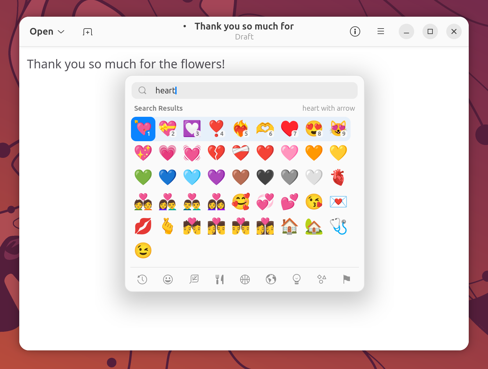

# Emoji Picker

A macOS-style emoji picker that works in every app. Press `Super+.`, type a word in English or
Chinese, and press a number key: the emoji lands where you were typing.



## Why (vs stock Ubuntu)

Stock GNOME has no system-wide emoji picker. GTK apps have their own emoji chooser inside text
fields, but apps built with other toolkits, such as Chrome, Electron apps and Qt apps, do not share
it. The Emoji Picker lives in GNOME Shell itself, so it looks and behaves the same everywhere,
including XWayland apps, and adds things the toolkit choosers lack: Chinese keyword search,
one-key picking with `1`–`9`, and a shared list of recently used emoji.

## How to use

Press `Super+.` (or `Ctrl+Super+Space`) while typing in any app. The picker opens with the search
box focused, showing your recently used emoji (or Smileys & People if you have none yet). Start
typing to search; press the shortcut again to close it.

| Key | Action |
| --- | --- |
| `Super+.` or `Ctrl+Super+Space` | Open or close the picker |
| Type any text | Search (English or Chinese keywords) |
| `1`–`9` | Insert the 1st–9th emoji of the highlighted row |
| Arrow keys | Move the selection |
| `Page Up` / `Page Down` | Move the selection five rows up or down |
| `Enter` | Insert the selected emoji |
| `Tab` / `Shift+Tab` | Next / previous category |
| `Ctrl+Left` / `Ctrl+Right` | Previous / next category |
| `Esc` | Clear the search; press again to close |

With the mouse: point at an emoji to select it, click to insert it, click an icon in the bottom bar
to switch category, and click anywhere outside the picker to close it.

**Search.** Every word you type must match. English words match the emoji's Unicode name and its
keywords (`heart`, `cat`, `party`). Chinese words match Chinese names and keywords, so `猫`
finds the cat emoji and `生日` finds birthday emoji such as 🎂 and 🎈. Typing pinyin in the search
box works as usual; while the input method is composing, the arrow, number, `Enter` and `Esc` keys go
to the input method rather than the picker.

**Categories.** About 1,900 emoji are grouped into Recently Used, Smileys & People, Animals & Nature,
Food & Drink, Activity, Travel & Places, Objects, Symbols, and Flags. The name of the selected emoji
is shown at the top right.

**Recently used.** Every emoji you insert moves to the front of Recently Used, which keeps the last
36 by default.

**Where it opens.** Under the text cursor when GNOME Shell knows where the cursor is. This setup uses
fcitx5 for input, and most apps report their cursor to fcitx5 rather than to the shell, so usually
the picker opens centred on the screen of the window you were typing in.

### How the emoji is inserted

The picker inserts the emoji through the clipboard, which is the one method that works in every
kind of app:

1. It remembers your current clipboard and puts the emoji on the clipboard.
2. It returns focus to your app and sends `Ctrl+V`. Terminals get `Ctrl+Shift+V` instead.
3. About 0.8 seconds later it puts your previous clipboard back, unless something else has
   changed the clipboard in the meantime.

A few details:

- Only one format of the old clipboard is saved, in this order of preference: copied files, a PNG
  image, plain text. Rich text copied from a browser or office app therefore comes back as plain
  text. Clipboard contents larger than 64 MB, or from an app that does not answer within 0.3
  seconds, are not saved, and the emoji stays on the clipboard instead.
- If no window had focus (for example, you opened the picker over the desktop), the emoji is simply
  left on the clipboard for you to paste.
- If you switch to a different window before the paste happens, nothing is pasted and the emoji
  stays on the clipboard.

### Emoji font

Emoji are drawn with Noto Color Emoji, Ubuntu's standard color emoji font. The installer lists the
`fonts-noto-color-emoji` package so that it is never missing. The picker asks for the system's
generic `emoji` font family, so if you configure a different emoji font through fontconfig, the
picker uses that one. No other emoji font is shipped.

## Settings

There is no settings window. The options are GSettings keys, which you can change from a terminal;
changes take effect without logging out.

| Key | Default | Meaning |
| --- | --- | --- |
| `toggle-picker` | `['<Super>period', '<Control><Super>space']` | Shortcuts that open and close the picker |
| `recent-max` | `36` | How many recently used emoji to keep (9–90) |
| `skin-tone` | `0` | Skin tone for emoji that support it: `0` default yellow, `1` light to `5` dark |
| `restore-clipboard-delay` | `800` | Milliseconds before the previous clipboard is put back; `0` leaves the emoji on the clipboard |
| `terminal-wm-classes` | Common terminals | Window classes or app IDs that receive `Ctrl+Shift+V` instead of `Ctrl+V` |
| `recent-emoji` | `[]` | The Recently Used list itself |

Examples:

```sh
# Use a medium skin tone
gsettings set org.gnome.shell.extensions.emoji-picker skin-tone 3

# Only Super+. opens the picker
gsettings set org.gnome.shell.extensions.emoji-picker toggle-picker "['<Super>period']"

# Keep the emoji on the clipboard instead of restoring the old contents
gsettings set org.gnome.shell.extensions.emoji-picker restore-clipboard-delay 0

# Clear the Recently Used list
gsettings reset org.gnome.shell.extensions.emoji-picker recent-emoji

# Undo all your changes
gsettings reset-recursively org.gnome.shell.extensions.emoji-picker
```

The picker follows the system style: it is dark when Settings > Appearance is set to Dark.

## Troubleshooting

**Nothing happens when I press `Super+.`**
Check that the extension is enabled with `gnome-extensions info emoji-picker@zihan.local`. The picker
does not open while the Activities overview, a menu, or another pop-up is open; close it first. Apps
that capture all keyboard shortcuts, such as virtual machines and remote-desktop viewers, receive the
keys themselves; press `Super+Esc` to take the shortcuts back. If another shortcut uses the same
keys, change `toggle-picker` as shown above.

**The emoji is not inserted, or the wrong thing is pasted.**
The app may not paste with `Ctrl+V`, for example a terminal that is not in the built-in list. Add the
app's window class to `terminal-wm-classes`: run
`gsettings get org.gnome.shell.extensions.emoji-picker terminal-wm-classes`, then `gsettings set` the
same list with the new name added. For apps where neither shortcut pastes, set
`restore-clipboard-delay` to `0` and paste the emoji yourself.

**My previous clipboard was not restored.**
It is restored only if nothing else changed the clipboard first, and only in one format (see "How the
emoji is inserted" above). Very large contents (over 64 MB) are never saved.

**The picker opens in the middle of the screen instead of at the cursor.**
This is expected in most apps; see "Where it opens" above.

**The pinyin candidate bar appears in the wrong place while searching.**
This is handled by the IME Cursor Scale extension; see [pinyin-input.md](pinyin-input.md).

**Emoji appear as empty boxes or in black and white.**
Make sure the emoji font is installed with `sudo apt install fonts-noto-color-emoji`, and check that
`fc-match emoji` names a color emoji font.

## See also

- [pinyin-input.md](pinyin-input.md): Chinese input and the candidate bar
- [shortcut-cheatsheet.md](shortcut-cheatsheet.md): hold `Super` to see all shortcuts, including this one
- [Feature inventory](../FEATURES-INVENTORY.md)
- [Project README](../../README.md)
