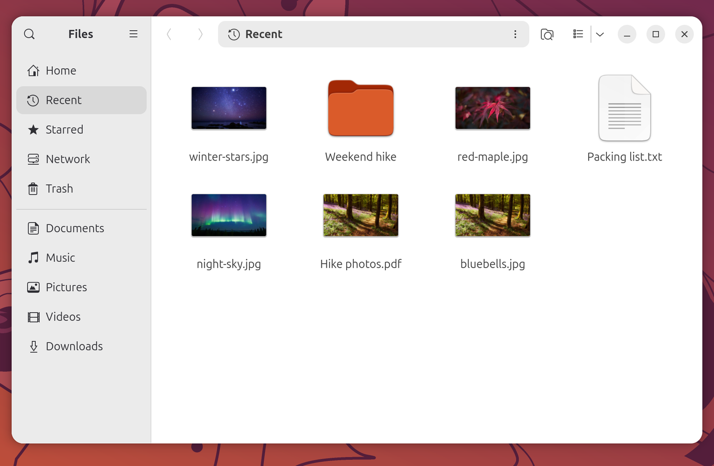
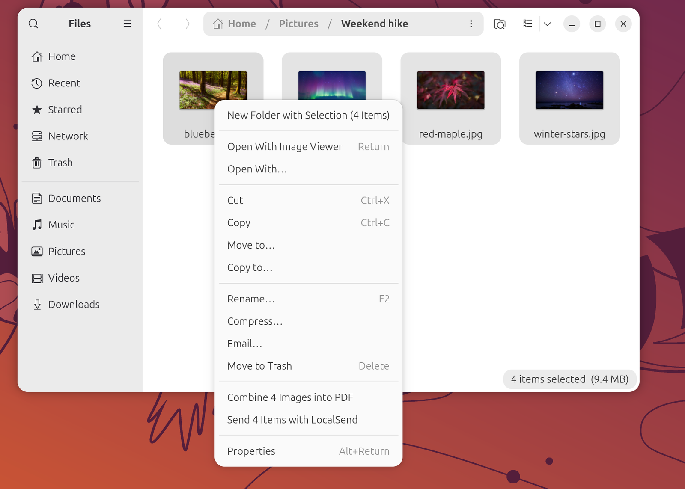
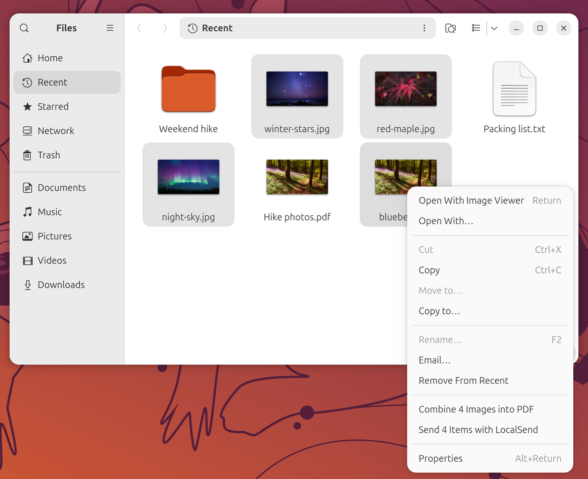

# Files

GNOME Files (Nautilus) gets a more useful **Recent** view, two extra right-click actions, and
AirDrop-style sharing through LocalSend. The desktop icons are patched too.

- [Recent folders](#recent-folders)
- [Thumbnails in Recent](#thumbnails-in-recent)
- [Real paths when copying from Recent](#real-paths-when-copying-from-recent)
- [Convert or combine images into a PDF](#convert-or-combine-images-into-a-pdf)
- [Send with LocalSend](#send-with-localsend)
- [Menu items in Recent](#menu-items-in-recent)
- [Desktop icons](#desktop-icons)

---

## Recent folders

### What's different from stock

Stock Files lists only files under **Recent**. Recently used folders now appear there too, and you
can open them or drop files onto them like any other folder. A folder is added when:

- you keep it open in a Files window for a couple of seconds, or
- another app opens, saves or downloads a file in it (screenshots and screen recordings do not
  count).

Your home folder, its standard folders (Desktop, Documents, Downloads and so on), hidden folders and
system locations such as `/tmp` are left out. The 30 most recent folders are kept.

### How to use

Automatic. Click **Recent** in the Files sidebar.

---

## Thumbnails in Recent

### What's different from stock

Stock Files cannot make thumbnails for items in **Recent**, so images and documents there show a
generic icon until you have viewed them in their real folder. A small background service creates
the thumbnails for the real files whenever your recent-files list changes, so Recent shows proper
previews (see the screenshot above).

### How to use

Automatic.

---

## Real paths when copying from Recent

### What's different from stock

In stock Files, copying an item in **Recent** puts an internal `recent:///…` address on the
clipboard, which is useless in a terminal, a chat box or another app. The Recent Clipboard Paths
extension rewrites the clipboard to the real file: pasting as text gives the normal file path, and
pasting into Files pastes the actual file. Copy and cut both work.

### How to use

Select items in **Recent**, press `Ctrl+C` (or right-click and choose **Copy**), and paste anywhere.

---

## Convert or combine images into a PDF

### What's different from stock

A new right-click item turns images into a PDF, which stock Files cannot do:

- one image selected: **Convert to PDF**
- several images selected: **Combine N Images into PDF**

The images are placed in natural file-name order (so `2.jpg` comes before `10.jpg`). The PDF is
saved next to the first image and named after it (`photo.pdf`, or `photo 2.pdf` if that name is
taken). A notification confirms it and the PDF opens. The conversion is done by the View app,
which the package installs.

### How to use

Select one or more images, right-click, and choose the PDF item. It only appears when every
selected item is an image stored on this computer.

---

## Send with LocalSend

### What's different from stock

[LocalSend](https://localsend.org) is an open-source, AirDrop-like app for sending files to nearby
phones and computers on the same network. The package installs it and starts it hidden at login, with its
icon in the top bar. Files gets a
**Send with LocalSend** item (**Send N Items with LocalSend** for several) that adds the selected
files and folders to LocalSend's send list and brings LocalSend to the front, where you pick the
device.

LocalSend runs as a snap, which can only read non-hidden files in your home folder. Anything else
you send this way is first copied to `~/snap/localsend/common/outbox`; those copies are deleted
after a day.

### How to use

Select files or folders in Files, right-click, choose **Send with LocalSend**, then click the
receiving device in LocalSend. To receive files, keep LocalSend running, as it is by default. The
item is not offered for items in Trash or on network locations.

---

## Menu items in Recent

Both **Combine Images into PDF** and **Send with LocalSend** also work on items in **Recent**:
they act on the real files behind the Recent entries.

---

## Desktop icons

### What's different from stock

Ubuntu's desktop icons are patched in two ways:

- Selecting a file on the desktop and pressing `Space` opens a quick preview (GNOME's Sushi
  previewer), as it does in Files.
- Desktop icons stay on the primary monitor and no longer jump to another screen when you dock or
  undock; other monitors are only used when the primary one is full.

The patch is re-applied automatically after Ubuntu updates the desktop-icons package.

### How to use

Click a file on the desktop and press `Space`.

---

## Troubleshooting

- **A new menu item does not appear.** Restart Files with `nautilus -q` and open it again.
- **Copying from Recent still pastes `recent:///…`.** The extension needs a small helper that is
  compiled during installation; if the build failed, the extension stays inactive. Check that
  `/usr/share/gnome-shell/extensions/recent-clipboard-paths@zihan.local/libmultisource.so` exists,
  and that the extension is switched on in the Extensions app. On Wayland, an extension that was
  just installed or updated only takes effect after you log out and back in.
- **Recent shows no folders or no thumbnails.** Both come from per-user background services.
  Check them with `systemctl --user status recent-folders recent-thumbnails`, and restart them with
  `systemctl --user restart recent-folders recent-thumbnails`.
- **The PDF item is missing.** It appears only when every selected item is a local image, and only
  when the View app is installed.
- **Space no longer previews desktop files after an update.** If a desktop-icons update changed
  the code, the patch may no longer apply; `journalctl -t preload-reapply` then shows "DING patch
  no longer applies".

## See also

- [Features inventory](../FEATURES-INVENTORY.md)
- [Project README](../../README.md)
