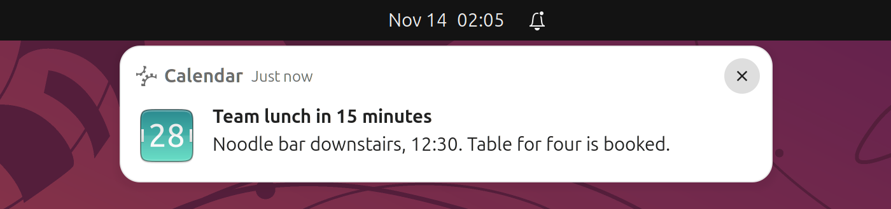

# Notifications

Two GNOME Shell extensions make notification banners behave more like macOS: banners are brief,
the newest one always wins, full-screen apps no longer silence everything else, and Do Not Disturb
really means do not disturb. Nothing is lost along the way: every notification still goes to the
notification list.

- [Notification Banners](#notification-banners)
- [DND Hides Critical](#dnd-hides-critical)

---

## Notification Banners

### What's different from stock

| Stock GNOME | With Notification Banners |
| --- | --- |
| A banner's timeout only starts once you use the keyboard or mouse, so a banner that arrives while you are away stays on screen until you come back. "Critical" banners (Chrome sends these, for example for Teams messages) never time out. | Every banner closes after at most **5 seconds**, critical ones included. It stays while the pointer is on it or it has keyboard focus (for example, while you type a reply), and an update to the banner restarts its 5 seconds. |
| Banners queue up and are shown one after another, each waiting for its own timeout, so old messages can pop up minutes later. | A new banner replaces the one on screen straight away. Only the newest waiting banner is kept, and one that could not be shown within 10 seconds is dropped. |
| While any window is full screen on the primary monitor, all non-critical banners are held back. | In full screen, only banners from the app you are looking at are held back. Banners from other apps still appear. |

Closing or dropping a banner only removes it from the screen; the notification stays in the
notification list. Do Not Disturb still holds back banners as before.

### How to use

Automatic. Open the notification list with `Super+V` or by clicking the clock to see everything
that arrived.

---

## DND Hides Critical

### What's different from stock

With Do Not Disturb on, stock GNOME still shows "critical" banners. Chrome marks some web
notifications as critical, so Teams chat messages in Chrome, for example, keep appearing through Do
Not Disturb, and neither GNOME nor Chrome has a setting to stop it. With this extension, Do Not
Disturb hides every banner, critical ones included. The same goes for apps whose banners you have
turned off in Settings > Notifications. The notifications still land in the notification list.

### How to use

Turn on **Do Not Disturb** in the notification list (`Super+V`, or click the clock). Turn it off to
get banners back. Because [Notification Banners](#notification-banners) drops banners that waited
more than 10 seconds, you will not get a burst of old banners when you turn Do Not Disturb off.

---

## Troubleshooting

- **Banners still behave the stock way.** On Wayland, a new or updated extension only takes effect
  after you log out and back in. Also check in the Extensions app that "Notification banners" and
  "DND Hides Critical Banners" are switched on.
- **I missed a banner.** Open the notification list (`Super+V`); every notification is kept there.
- **A full-screen app's own banners do not show.** That is intended for its non-critical banners:
  you are already looking at that app.

## See also

- [Windows and workspaces](workspaces.md)
- [Features inventory](../FEATURES-INVENTORY.md)
- [Project README](../../README.md)
