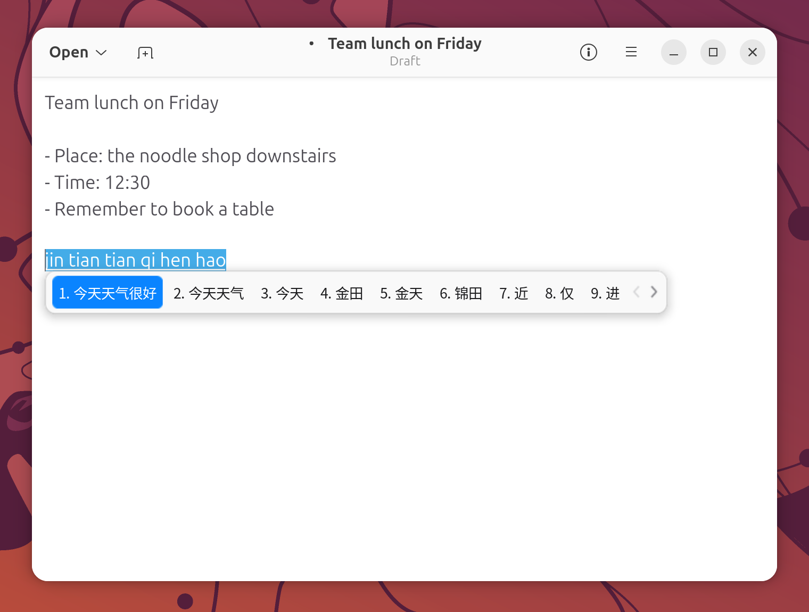
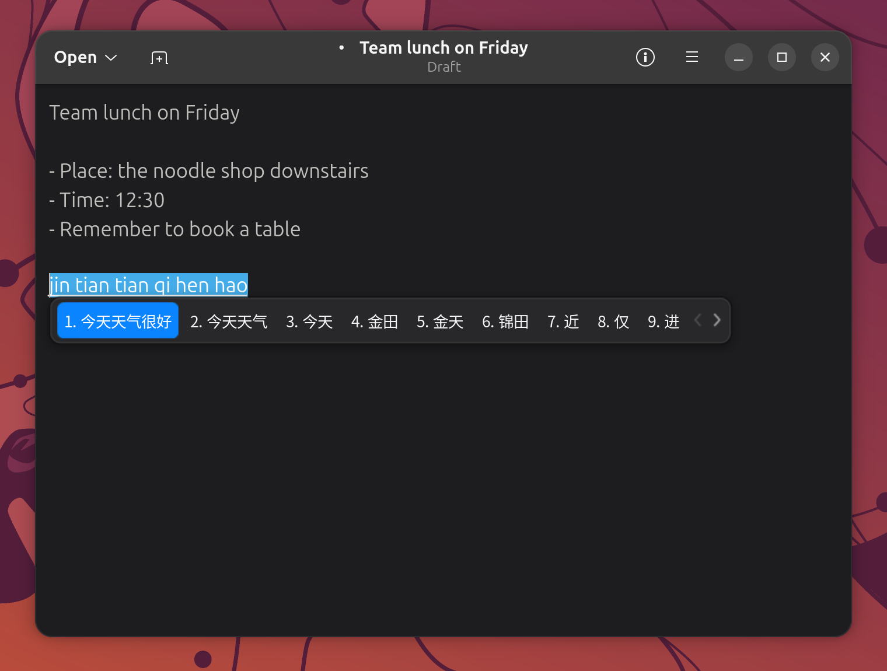

# Chinese input (fcitx5 pinyin)

Type Chinese anywhere on the desktop with fcitx5 pinyin: in GTK and Qt apps, in Chrome and Electron
apps, in WeChat, and in GNOME Shell's own fields such as the overview search box. The candidate bar
uses a macOS-style look that follows your light or dark style, and it appears under the cursor, also
on setups where the monitors use different scaling.

<table>
  <tr>
    <td></td>
    <td></td>
  </tr>
  <tr>
    <td align="center">Light style (<code>mac-light</code>)</td>
    <td align="center">Dark style (<code>mac-dark</code>)</td>
  </tr>
</table>

## Why (vs stock Ubuntu)

- **fcitx5 actually starts.** On stock Ubuntu GNOME, fcitx5 never starts even when it is installed:
  im-config's autostart does nothing while ibus is present, and GNOME starts ibus-daemon instead.
  Here fcitx5 starts at login for every user and ibus-daemon is kept out of the way, so pinyin works
  for new users right after installation.
- **Every toolkit uses fcitx5.** GTK, Qt, XWayland and Electron apps are all pointed at fcitx5. GNOME
  Shell talks to fcitx5 through fcitx5's IBus frontend, so pinyin also works in the overview search.
- **A calmer, macOS-style candidate bar.** Stock fcitx5 draws a dark bar tinted with the GNOME accent
  colour. This setup ships rounded `mac-light` / `mac-dark` themes with a soft shadow and a blue
  highlight, and cloud pinyin is tuned so the bar no longer blinks while you type long phrases.
- **Candidates at the cursor.** Chrome, the Claude desktop app, other Electron apps and GNOME Shell's
  own text fields no longer put the candidate bar in the wrong place when monitors use different
  scaling.
- **WeChat uses the system input method.** WeChat for Linux bundles its own input module. It is
  launched so that the system fcitx5 draws its candidates and its desktop notifications still work.

## How to use

Press **Ctrl+Space** to switch between English and pinyin. The US keyboard is the first input
method, so typing starts in English. Each window keeps its own state, so switching one app to pinyin
does not affect the others.

While typing pinyin:

| Key | Action |
| --- | --- |
| `Space` | Commit the highlighted candidate |
| `1` to `9` | Pick a candidate by number |
| `Left` / `Right`, `Tab` / `Shift+Tab` | Move the highlight along the bar |
| `-` / `=`, `Up` / `Down`, `Page Up` / `Page Down` | Previous / next page of candidates |
| `Enter` | Commit the typed letters as they are |
| `Ctrl+.` | Toggle Chinese / English punctuation |
| `Ctrl+Alt+Shift+C` | Turn cloud pinyin on or off |

The bar is a single horizontal row with nine candidates per page.

### fcitx5 starts at login

fcitx5 is started for every user at login, and GNOME's ibus-daemon is skipped while fcitx5 is the
configured input method. You do not need to run im-config or add anything to your startup apps. If you
switch the input method back to ibus yourself, ibus starts again as on stock Ubuntu.

### macOS-style themes that follow light and dark

The candidate bar uses `mac-light` in the light style and `mac-dark` in the dark style. fcitx5 follows
the system colour scheme, so when you switch between Light and Dark in **Settings > Appearance**, the
bar switches with it. The highlight is always macOS blue rather than the GNOME accent colour.

The themes are installed for every user. They are the default for new accounts and for accounts whose
fcitx5 settings came from an earlier release with the stock themes (those are switched once during an
update). If you had already picked another theme yourself, your choice is kept.

### Cloud pinyin without flicker

Cloud pinyin asks an online service for a better guess on long phrases and adds it to the candidate
bar. With stock settings this made the bar blink on every key: the cloud candidate sat in slot 2,
showed a loading placeholder, and then changed size when the answer arrived, pushing the local
candidates around.

Here the cloud candidate is placed in the last slot of the page (slot 9) and its loading animation is
off, so the local candidates stay put while the cloud result loads. To use the cloud suggestion, press
`9`. The cloud is only asked once the pinyin is at least four letters long, and the Google backend is
used. `Ctrl+Alt+Shift+C` turns cloud pinyin on or off.

### Candidate position in Chrome, Claude and Electron apps

On Wayland, fcitx5 places the candidate window in the wrong spot in Chrome, the Claude desktop app and
other Electron apps when monitors use different scaling. These apps therefore run under XWayland,
where the window lands at the cursor:

- The Chrome and Claude launchers are rewritten to start on XWayland, and they are re-patched
  automatically after every package upgrade.
- Chrome web apps (PWAs) such as installed sites are re-patched whenever Chrome regenerates their
  launchers.
- Chrome is started in the background on XWayland at login, so later launches reuse that process.
- Other Electron apps are asked to prefer XWayland through the session environment.

### IME Cursor Scale (GNOME Shell text fields)

When you type into GNOME Shell's own fields, such as the overview search box or the
[emoji picker](emoji-picker.md), with display scaling on, the candidate bar could appear at roughly
half the expected position, sometimes on another monitor. The IME Cursor Scale extension
(`ime-cursor-scale@zihan.local`, enabled by default) corrects the reported cursor position so the bar
appears right under the cursor. It also keeps the bar visible above the overview and the emoji picker,
and hides a field's placeholder text while you are composing pinyin.

### WeChat

WeChat for Linux (4.1) bundles its own Qt and its own fcitx5 input module. Left alone, on Wayland it
draws a blinking candidate popup of its own, and when it is forced onto XWayland pinyin works but
WeChat sends no desktop notifications.

The WeChat launcher is therefore replaced: WeChat runs natively on Wayland and types through Wayland's
text-input protocol. GNOME Shell passes the input to fcitx5, so the normal macOS-style candidate bar
appears at the cursor, and WeChat's notifications work (see [Notifications](notifications.md)). The
launcher is regenerated from WeChat's own entry after every package upgrade, so it survives WeChat
updates.

This only applies when WeChat is started from the app grid or the dock. See
[Known limitations](#known-limitations).

### Voice typing (Vocalinux)

For dictation, Vocalinux (local, offline speech-to-text) also types into any app, including Chinese.
Its default hotkey is push-to-talk on **Left Alt**: hold Left Alt while you speak and release it when
you are done. You can change the hotkey in Vocalinux's own settings. The speech model downloads on first use.

## Settings

Most settings are in **Fcitx 5 Configuration**: open it from the app grid or run
`fcitx5-configtool`.

- **Change the switching shortcut:** Global Options tab, **Toggle Input Method**. The default is
  `Ctrl+Space`.
- **Change the theme:** Addons tab, **Classic User Interface**. **Theme** is used in the light style
  and **Dark Theme** in the dark style; turn off **Follow system light/dark color scheme** to always
  use **Theme**. The same settings live in `~/.config/fcitx5/conf/classicui.conf` (`Theme`,
  `DarkTheme`, `UseDarkTheme`).
- **Turn cloud pinyin off:** press `Ctrl+Alt+Shift+C`, or in the Addons tab open **Pinyin** and clear
  **Enable Cloud Pinyin**. **Cloud Pinyin Candidate Order** and **Show animation when Cloud Pinyin is
  loading** are there too.
- **Change the cloud service:** Addons tab, **Cloud Pinyin**, **Backend** (for example Baidu if Google
  is slow where you are). **Minimum Pinyin Length** sets when the cloud is asked.
- **Stop fcitx5 starting at login:** create `~/.config/autostart/org.fcitx.Fcitx5.desktop` containing
  `Hidden=true` under a `[Desktop Entry]` line. It overrides the system-wide entry of the same name.

## Known limitations

- **WeChat started another way uses its own popup.** The fix lives in WeChat's app-grid launcher. If
  WeChat is started any other way, for example by a login item WeChat creates itself or by running
  `/usr/bin/wechat` from a terminal, it bypasses that launcher and shows its bundled, blinking input
  popup again. Start it from the app grid or the dock instead.
- **Cloud pinyin is an online service.** With it on, the pinyin you type (four letters or longer) is
  sent to the cloud backend. Turn it off if you prefer to keep all input local.
- **Theme defaults only reach accounts without their own choice.** Accounts that already had
  customised fcitx5 settings keep them; pick `mac-light` / `mac-dark` yourself if you want them.
- **New settings need a fresh login.** The input-method environment and the IME Cursor Scale extension
  take effect after you log out and back in, for example right after the first installation.

## Troubleshooting

**Ctrl+Space does nothing, or no candidates appear.**
Check that fcitx5 is running with `pgrep -x fcitx5`. If it is not, start it with `fcitx5 -d` and log
out and back in. `echo $GTK_IM_MODULE` should print `fcitx`; if it does not, the session was started
before the input-method settings were installed, and a fresh login fixes it. Also check that you have
not disabled `~/.config/autostart/org.fcitx.Fcitx5.desktop`.

**Pinyin works in apps but not in the overview search.**
GNOME Shell reaches fcitx5 through its IBus frontend. If `pgrep -x ibus-daemon` shows that ibus-daemon
is running, the session started without the fcitx5 settings; log out and back in.

**The candidate bar is in the wrong place in Chrome or a Chrome web app.**
Chrome reuses an already running process, so a Chrome that was first started some other way (for
example from a terminal) stays on Wayland. Quit Chrome completely (Chrome menu, Exit) and start it
again from the app grid or the dock. If an Electron app still misplaces the
bar, starting it with `--ozone-platform=x11` puts it on XWayland too.

**The candidate bar is in the wrong place in the overview search or the emoji picker.**
Make sure IME Cursor Scale is enabled: `gnome-extensions info ime-cursor-scale@zihan.local` should show
it as enabled. After an update, log out and back in so the new version loads.

**WeChat shows its own blinking popup instead of the normal candidate bar.**
Quit WeChat completely and start it from the app grid or the dock. If WeChat starts itself at login,
turn that off in WeChat's settings so it does not bypass the launcher. If the problem remains, check
that `/usr/local/share/applications/wechat.desktop` exists; running
`sudo /usr/local/lib/preload/reapply.sh` regenerates it.

**The bar stays light in the dark style (or the other way round).**
In Fcitx 5 Configuration, check that **Follow system light/dark color scheme** is on under Classic User
Interface, and that **Theme** and **Dark Theme** are `mac-light` and `mac-dark`.

## See also

- [Emoji picker](emoji-picker.md)
- [Notifications](notifications.md)
- [Shortcut cheatsheet](shortcut-cheatsheet.md)
- [Features inventory: Input method](../FEATURES-INVENTORY.md#3-input-method)
- [Project README](../../README.md)
