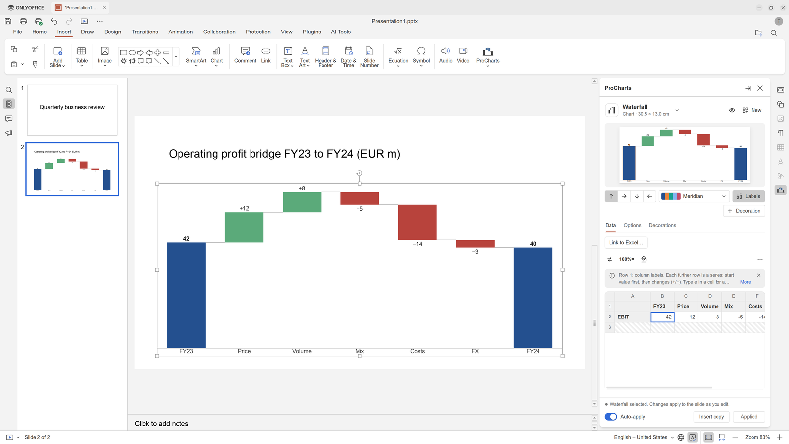
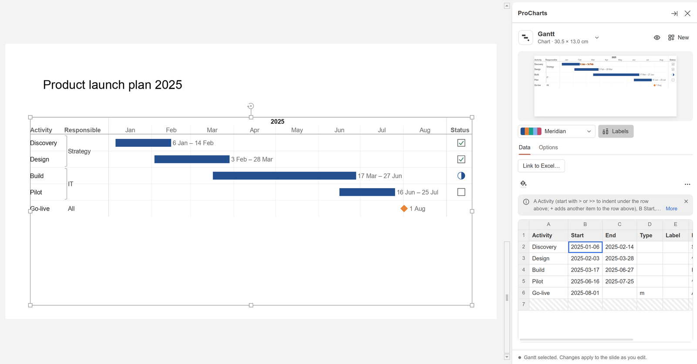
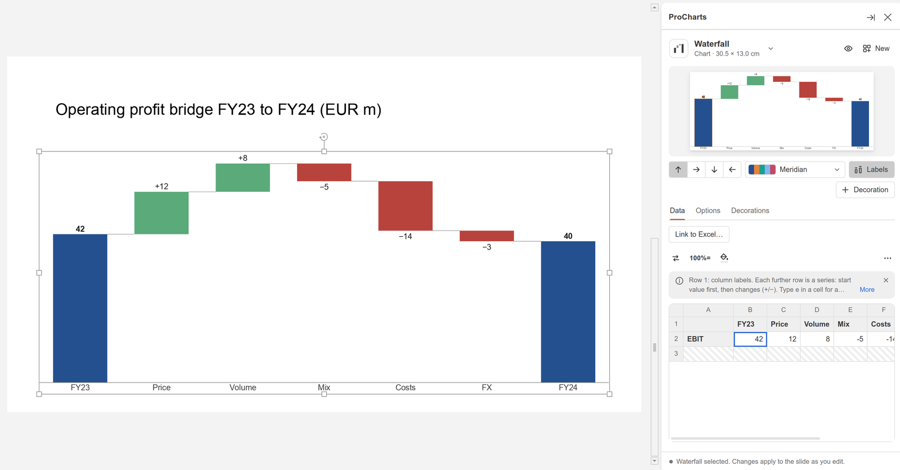

# ONLYOFFICE and ProCharts

[ONLYOFFICE Desktop Editors](https://www.onlyoffice.com/desktop.aspx) is a free office suite for
documents, spreadsheets, presentations and PDF files, with strong compatibility with Microsoft Office
formats. It comes preinstalled, together with **ProCharts**, a plugin that adds business charts and
diagrams to the ONLYOFFICE presentation editor: waterfalls, stacked and clustered columns and bars,
Mekko charts, Gantt timelines and more.

ProCharts draws every chart from ordinary slide shapes, so a chart saves, exports to PPTX and PDF and
animates like any other shape, and opens correctly for someone who does not have the plugin. The
chart's data is stored with the chart, so you can select it later and change the numbers.



## Why (vs stock Ubuntu)

Stock Ubuntu ships LibreOffice only. ONLYOFFICE is installed from ONLYOFFICE's own package
repository, so it receives updates together with the rest of the system (the repository's signing
key is shipped with this project).

ONLYOFFICE's built-in charts cover the standard types but not the charts business presentations
rely on, such as waterfalls, Mekko charts or Gantt timelines. ProCharts adds them, installed for
every user on the computer. It is reinstalled automatically after every ONLYOFFICE upgrade or
reinstall, and updated when a new version of this project ships a newer ProCharts.

## How to use

Open **ONLYOFFICE** from the app grid and create or open a presentation. ProCharts works in the
presentation editor only.

### Opening ProCharts

- **Insert tab > ProCharts.** Click the button to open the ProCharts panel on the right. Click the
  small arrow under it to pick a chart or element from a list and insert it straight away.
- **Plugins tab > ProCharts** also opens the panel.
- **Right-click a chart** that ProCharts made and choose **Edit ProCharts ...** to open the panel
  for that chart.

### Inserting a chart

With no ProCharts chart selected, the panel shows a gallery of rendered samples, grouped into
**Charts**, **Elements** and a **Ready-made** section of finished-looking starting points. Type in
the filter box to search by name or description, then click a sample to add it to the current slide
with sample data. If a shape on the slide is selected, you can turn on **Fit into the selected
shape** to place the new chart in its position and size.

Charts:

- Waterfall and build-down waterfall
- Stacked, 100% stacked and clustered columns (also as bars, see "Direction" below)
- Pipeline
- Line, area and 100% area
- Mekko and Mekko (units)
- Gantt
- Pie, doughnut and bar of pie
- Butterfly
- Range bars and box plot
- Scatter and bubble

Elements:

- Harvey ball, checkbox, rating
- Process flow, cycle, hub and spoke, pyramid, funnel, Venn, matrix
- Org chart, timeline, table, agenda
- Progress bar, ring gauge, dial gauge, thermometer, traffic light



### Editing a chart

Select a ProCharts chart on the slide and the panel switches to it. At the top you see the chart
type (use the arrow next to it to switch to another type), a live preview, and quick controls for
the colour scheme and labels. Charts that support it also have direction buttons (columns growing
up, bars growing right, hanging columns, bars from the right) and a **Decoration** button. Below are
these tabs:

- **Data**: a small spreadsheet with the chart's numbers. A hint above it explains the layout the
  chart expects. Type values directly, or use the **...** menu above the sheet to paste rows
  copied from a spreadsheet, reset to the sample data or clear the values. **Link to Excel...**
  fills the chart from a range in an .xlsx file and can refresh it later.
- **Options**: settings for the chart type, such as labels, sort order, axes and colours.
- **Decorations** (charts that support them): annotations such as a value line, axis break,
  CAGR arrow, difference arrow, level difference arrow, 100% indicator and series connectors.

With **Auto-apply** on (the default), the slide updates shortly after each edit. Turn it off to
collect changes and press **Apply** instead. **Insert copy** adds a copy of the chart to the current
slide. **New** returns to the gallery.

Right-clicking a chart also offers a **ProCharts** submenu with quick actions where they apply, for
example **Sort categories**, **Rotate chart 90°**, **Flip chart**, **Draw series as line**,
**Use right axis** and, for linked charts, **Refresh from Excel**.



## Settings

There is nothing to configure outside ONLYOFFICE. All chart settings live in the ProCharts panel and
are saved with each chart in the presentation.

## Troubleshooting

- **There is no ProCharts button on the Insert tab.** Make sure you are in a presentation, not a
  document or spreadsheet. If ONLYOFFICE was open while it was installed or updated, close every
  ONLYOFFICE window and start it again. You can check that the plugin is installed with:

  ```
  ls /opt/onlyoffice/desktopeditors/editors/sdkjs-plugins/ | grep 7F4053D3
  ```

  If nothing is printed, reinstall the plugin with `sudo /usr/local/lib/preload/reapply.sh` (it also
  runs automatically after every package installation or upgrade). Messages from that step can be
  read with `journalctl -t preload-reapply`.
- **The panel does not switch to my chart.** The panel edits one chart at a time: select only
  that chart, not several objects. Right-clicking the chart and choosing **Edit ProCharts ...**
  also brings it up.
- **A colleague without ProCharts opens my file.** The chart looks the same, because it is made of
  ordinary shapes, but they can only edit the individual shapes, not the chart data.
- **A linked Excel chart shows "File not found" or "The file has changed".** The linked .xlsx file
  was moved or edited. Use **Refresh from Excel** to read it again, or link the chart to the file's
  new location from the Data tab.

## See also

- [Features inventory](../FEATURES-INVENTORY.md), section "5. Other system and desktop features"
- [Files](files.md)
- [Project README](../../README.md)
