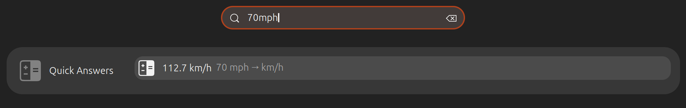
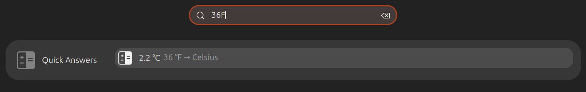
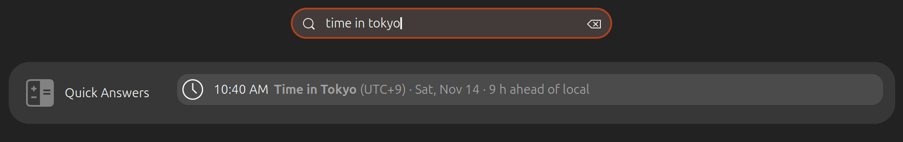
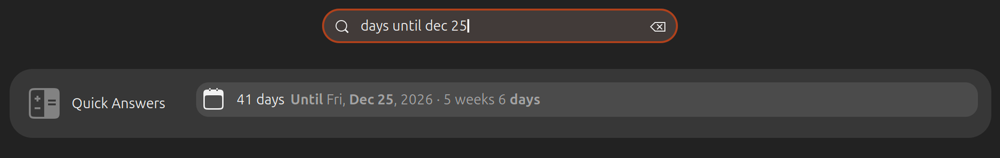
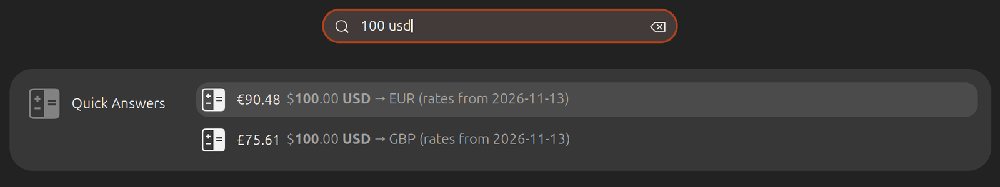
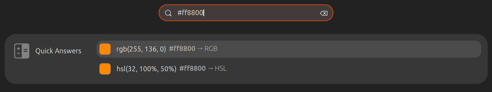
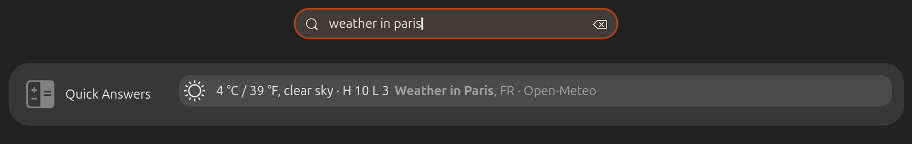
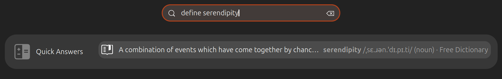
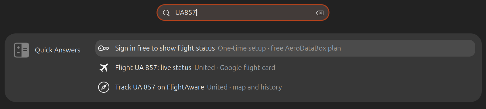
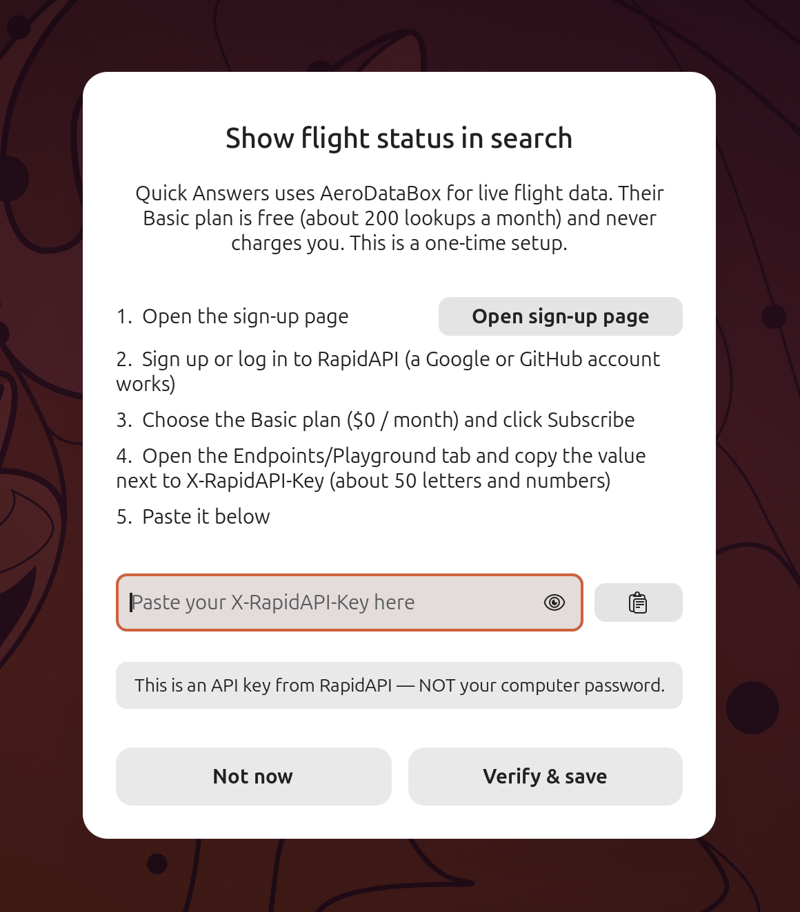

# Quick Answers

Quick Answers puts instant answers at the top of the GNOME overview search, much like Spotlight on
macOS. Press `Super`, type something like `36F`, `3pm PST`, `100 usd` or `weather in Paris`, and the
answer appears above your apps and files. Press `Enter` to copy it. It handles units, temperatures,
time zones, date math, currency, colours, number bases, Unix timestamps, weather, word definitions,
parcel tracking numbers and flight numbers. When it doesn't recognise what you typed, it shows
nothing at all. It is the `smart-search@zihan.local` GNOME Shell extension and is turned on by default.

## Why (vs stock Ubuntu)

Stock Ubuntu's overview search is mainly a launcher: it finds apps, settings and files. For anything
else you need to open a browser or a separate app. Quick Answers covers the everyday lookups in the
search box you already use. It reads the shorthand people actually type (`6'7`, `70mph`, `3斤`,
`27"`, `9am Beijing`), works out the most useful conversion direction itself, and needs no account.
The one exception is the optional live flight card, which uses your own free key.

## How to use

1. Press `Super` to open the overview.
2. Start typing. A **Quick Answers** group appears at the top of the results with up to three rows.
3. Press `Enter` for the first row, or click any row:
   - **Answers** (conversions, times, dates, colours and so on) are copied to the clipboard, and a
     short "Copied …" message confirms it.
   - **Lookups** (weather, definitions, flights, parcel tracking) open the matching web page in
     your default browser.

What gets copied is the useful part: currency answers are copied as a plain number without
thousands separators, day counts as just the number, and date-math results as `YYYY-MM-DD`.

### Units

Type a number and a unit. Quick Answers picks the conversion for you: metric becomes imperial and the
other way round. To pick the target unit yourself, add `to`, `in`, `into`, `as`, `=` or `->`.



| Kind | Example queries |
| --- | --- |
| Length and height | `5 km`, `180 cm`, `6'7`, `5 ft 11 in`, `1米8`, `3 miles to km` |
| Weight | `70 kg`, `12 oz`, `11 stone`, `3斤`, `2两` |
| Volume and cooking | `500 ml`, `2 cups`, `1 tbsp`, `1 gal`, `12 fl oz` |
| Area | `1200 sqft`, `100平米`, `2 acres`, `5 ha`, `2亩` |
| Speed | `70mph`, `100 km/h`, `20 knots` |
| Fuel economy | `30 mpg` (to L/100 km), `6 l/100km` |
| Pressure | `32 psi`, `2.2 bar`, `1013 hPa` |
| Data size | `500 GB` (to GiB), `16 GiB`, `100 Mb` (megabits) |
| Data rate | `100 Mbps` (to MB/s), `50 MB/s` |
| Download time | `20 GB at 100 Mbps` |
| Durations | `90 min` (1 h 30 min, 1.5 h), `3600 sec`, `2.5 h`, `90 min in hours` |
| Screen size | `27"` (inches to cm, plus the width × height of a 16:9 panel) |

Data units follow the usual convention: `MB`/`mb` means megabytes, while a capitalised `Mb` or `Mbps`
means megabits.

### Temperature

`36F`, `36 °F`, `20C`, `20 celsius` and `-40 F` are all recognised, and the conversion runs in the
other direction automatically.



### Time zones

| Query | Answer |
| --- | --- |
| `time in Tokyo`, `Tokyo time`, `time London` | The current time there, its UTC offset, the date, and how far ahead of or behind your local time it is |
| `3pm PST`, `9am Beijing`, `10:30 EST` | That time in your local zone and in Beijing time. If either one is the zone you typed, UTC is shown instead. |
| `10:30 EST in CET`, `3pm London to Tokyo` | The time in the zone you asked for, followed by your local time and Beijing time, leaving out any that are the same zone as the one you typed |

If the result falls on another day, that day is shown too. Your local time comes from the system time
zone, and a change to it is picked up within a minute.

Quick Answers knows a fixed list of about 200 names covering some 60 zones: common abbreviations
(`PST`, `EST`, `CST`, `MST`, `UTC`, `GMT`, `BST`, `CET`, `JST`, `KST`, `IST`, `AEST`, `SGT`, `HKT`
and others) plus major cities and countries (`New York`, `SF`, `London`, `Paris`, `Berlin`, `Dubai`,
`Singapore`, `Sydney`, `São Paulo`, `北京`, `上海` and so on). Smaller places aren't recognised.



### Date math

| Query | Answer |
| --- | --- |
| `days until Dec 25`, `how many days until 2027-01-01` | Days from today, with weeks for longer spans |
| `days since Jan 1` | Days that have passed since that date |
| `Nov 13 + 90 days`, `today + 2 weeks`, `2026-03-31 + 1 month`, `tomorrow - 1 year` | The resulting date |
| `Jan 1 to Mar 1`, `2026-01-01 - 2026-12-31` | Number of days between two dates |

Dates can be written as `2026-12-25`, `12/25`, `12/25/26`, `Dec 25`, `25 Dec`, `December 25 2026`,
`today`, `tomorrow` or `yesterday`. If you leave out the year, "until" looks ahead to the next one and
"since" looks back to the last one.



### Unix timestamps

Paste a 10-digit (seconds) or 13-digit (milliseconds) timestamp, such as `1767225600`, to see it as a
local date and time along with the UTC ISO form. Only timestamps from 2001 up to the end of 2039 are
treated this way.

### Currency

Type an amount with a currency code, symbol or name: `100 usd`, `€50`, `£20`, `$5k`, `100 CAD`,
`5000 yen`, `200 rmb`, `100元`. You get the amount in your target currencies, which are US dollar,
euro and pound unless you change them (see [Settings](#settings)). To convert to one particular
currency, add `to` or `in`: `100 usd to jpy`.



The 31 currencies published by the European Central Bank are supported, including USD, EUR, GBP, JPY,
CNY, CAD, AUD, CHF, HKD, SGD, KRW, INR and MXN. Each answer shows the date of the rates it used. A few
things to note:

- `¥` on its own means Chinese yuan. For Japanese yen, write `JP¥`, `yen` or `JPY`.
- `$` means US dollars. Other dollars have their own prefixes: `C$`, `A$`, `HK$`, `NZ$`, `S$`.
- The codes `TRY`, `PHP`, `ISK` and `RON` must be typed in capitals, because the lowercase versions
  are ordinary words.

### Colours and number bases

| Query | Answer |
| --- | --- |
| `#ff8800`, `#f80`, `#ff880080` | The colour in RGB (or RGBA) and HSL, with a colour swatch |
| `rgb(255, 136, 0)` | The colour in hex and HSL |
| `0xff`, `0b1010`, `0o17` | The number in decimal, plus its hex and binary forms (whichever you didn't type) |
| `255 in hex`, `42 to binary`, `0xff as octal` | The number in the base you asked for |



### Weather

Type `weather` for your own city, or `weather in Paris` / `weather for London` for anywhere else. The
row shows the current temperature in °C and °F, the conditions, and today's high and low in °C.
Clicking it opens a web search for the full forecast.

When you type just `weather`, Quick Answers uses the `weatherCity` setting. If that is empty, it uses
the city in your system time zone's name (for example, `America/New_York` gives New York).



### Definitions

`define serendipity`, `definition of ephemeral` and `meaning of ubiquitous` show the first English
dictionary definition, with pronunciation and part of speech. Clicking the row opens the full entry.
If a word isn't found, the row offers a web search instead.



### Parcel tracking

Type a carrier name followed by the number (`ups 1Z…`, `usps 9400…`, `fedex 1234…`), or just paste the
tracking number. UPS numbers starting with `1Z`, 20 to 22-digit USPS numbers starting with 92 to 95,
and 12 or 15-digit FedEx numbers are detected automatically. The row opens the carrier's tracking
page.

### Flights

Type a flight number such as `UA857`, `UA 857` or `dl1847`. More than 80 major airlines are recognised,
covering North America, Europe, the Middle East, Africa, Asia and Oceania. To avoid catching other
words, a lowercase number needs at least two digits and can't look like a year (`vs2022` is ignored).

**Without a key** (out of the box) you see three rows:

1. **Sign in free to show flight status**, which starts the one-time key setup described below.
2. **Flight UA 857: live status**, which opens Google's flight status card in your browser.
3. **Track UA 857 on FlightAware**, which opens the flight's map and history on FlightAware.



**With your own key**, the flight's status appears right in the search results. Each card has the
route and the departure and arrival times, then the status (Scheduled, Boarding, Departed, In flight,
Landed, Delayed, Canceled, Diverted and so on), terminal, gate and baggage belt when known, and how
late or early the flight is running. If the flight number is a codeshare, the card also shows the
operating flight number. For a multi-leg flight you see the leg nearest to now plus the connecting
leg. Quick Answers looks up today's flights and also checks tomorrow's when there is nothing left
today. Clicking a card opens Google's flight card, and the attribution row "Flight data by
AeroDataBox" is always shown alongside.

#### Setting up your free flight-status key

Quick Answers ships without an API key. Live flight data comes from
[AeroDataBox](https://aerodatabox.com) through RapidAPI, and its Basic plan is free (about 200 lookups
a month).



1. Search for any flight number and choose **Sign in free to show flight status**. The overview closes
   and the **Show flight status in search** dialog opens.
2. Click **Open sign-up page**. It opens the AeroDataBox pricing page on RapidAPI.
3. Sign up or log in to RapidAPI (a Google or GitHub account works), choose the **Basic** plan
   ($0 / month) and click **Subscribe**.
4. Open the **Endpoints** / **Playground** tab and copy the value next to `X-RapidAPI-Key` (about 50
   letters and numbers).
5. Paste it into the dialog, using `Ctrl+V` or the paste button, and click **Verify & save**.

   > This is an API key from RapidAPI. It is **not** your computer password.

**Verify & save** first checks locally that the text looks like a key. If it does, Quick Answers
looks up the flight you searched for, once, to confirm the key works. Then it saves the key and
shows a confirmation. Click **Done** and the overview reopens on your search, now with the flight
card. If the key is rejected, the dialog
tells you why:

- *"This key isn't subscribed to AeroDataBox yet"*: go back to RapidAPI, choose Basic and click
  Subscribe.
- *"RapidAPI rejected this key"*: the key wasn't copied completely. Copy `X-RapidAPI-Key` again.

**Not now** closes the dialog. The sign-in row keeps appearing for flight searches until a key is
saved.

**Manual setup.** You can also put the key in the key file yourself:

```bash
mkdir -p ~/.config/smart-search
umask 077; nano ~/.config/smart-search/aerodatabox.key   # paste the key on one line, save
chmod 600 ~/.config/smart-search/aerodatabox.key
```

The key takes effect as soon as the file is saved, with no need to log out. To remove the key, delete
the file.

**Monthly limit.** To stay inside the free plan, Quick Answers counts every AeroDataBox request,
including the one made during setup. It stops at 190 per calendar month and starts again the next
month. Lookups wait until you stop typing, and the result is reused for 5 minutes, so retyping the
same flight number doesn't cost extra lookups.

## Settings

Most people never need to change anything. The optional settings go in
`~/.config/smart-search/config.json`. Quick Answers notices changes as soon as you save, without a
log-out. To start, copy the example from the installed extension:

```bash
mkdir -p ~/.config/smart-search
cp /usr/share/gnome-shell/extensions/smart-search@zihan.local/config.example.json ~/.config/smart-search/config.json
```

```json
{
  "weatherCity": "",
  "currencyTargets": ["USD", "EUR", "GBP"],
  "flightStatus": {"provider": "aerodatabox", "apiKey": ""}
}
```

| Option | Default | Meaning |
| --- | --- | --- |
| `weatherCity` | `""` | City used when you type just `weather`. Leave it empty to use the city from your system time zone. |
| `currencyTargets` | `["USD", "EUR", "GBP"]` | Currencies an amount is converted into when you don't name a target. Use three-letter codes. The source currency is skipped, and at most three rows are shown. |
| `flightStatus.provider` | `"aerodatabox"` | Flight data provider. AeroDataBox is the only one supported. |
| `flightStatus.apiKey` | `""` | Fallback place for the AeroDataBox key. Use the key file `~/.config/smart-search/aerodatabox.key` instead. A key in that file always wins. |

The `_comment` entry in the example file is only a note and is ignored.

Files Quick Answers keeps:

| File | Purpose |
| --- | --- |
| `~/.config/smart-search/config.json` | Your settings (optional) |
| `~/.config/smart-search/aerodatabox.key` | Your flight-status key (optional, readable only by you) |
| `~/.cache/smart-search/rates.json` | Last downloaded exchange rates |
| `~/.cache/smart-search/aerodatabox-usage.json` | This month's AeroDataBox request count |

To turn Quick Answers off, use the Extensions app or run
`gnome-extensions disable smart-search@zihan.local`.

## Privacy / network

Most answers are calculated on your computer and need no network: units, temperature, time zones,
date math, timestamps, colours and number bases. Parcel tracking and the FlightAware and Google rows
are only links, so nothing is sent until you click one.

Four answer types fetch data. Requests go straight from your computer to the service. Nothing is sent
to the authors of this project.

| Answer | Service | What is sent | Kept for |
| --- | --- | --- | --- |
| Currency | [Frankfurter](https://frankfurter.dev) (European Central Bank rates) | A request for the latest rate table. Your amount is **not** sent; the maths happens locally. | 12 hours, saved to disk |
| Weather | [Open-Meteo](https://open-meteo.com) | The city name (to find it), then its coordinates (for the forecast) | 15 minutes |
| Definitions | [Free Dictionary API](https://dictionaryapi.dev) | The word | 24 hours |
| Flight status (only with your key) | AeroDataBox via RapidAPI | The flight number, today's date (and sometimes tomorrow's), and your key | 5 minutes |

A few more details:

- Lookups start only after you pause typing: 0.25 s for currency, weather and definitions, and 0.6 to
  1.5 s for flights, which use up your quota. Results are reused, so searching again doesn't send a
  new request until the time in the table has passed. A failed request is retried after a minute.
- Exchange rates are saved to disk. Once you have converted a currency, it keeps working offline with
  the last rates (the answer shows their date). Weather, definitions and flight status need a
  connection.
- Your flight key is sent only to AeroDataBox's RapidAPI address, in a request header. It is never
  written to the log. It lives in your own config folder, not inside the extension, so it is not
  touched by updates. If you saved it through the dialog, the file can only be read by you.

## Troubleshooting

**No Quick Answers group appears.** Quick Answers only responds to queries it understands, so plain
words like `firefox` correctly show nothing. A query needs a digit, a currency sign, or a keyword such
as `time`, `weather`, `define`, `days`, `today` or `#` (and at least two characters). It does not
evaluate arithmetic such as `12*7`. If nothing works at all, check that the extension is enabled:

```bash
gnome-extensions info smart-search@zihan.local
```

**Right after an update.** GNOME loads extensions when you log in, so a new version of Quick Answers
takes effect only after you log out and back in.

**Currency shows nothing.** The first currency answer needs an internet connection to download the
rates. After that, the saved rates are used offline. Also check the currency is one of the supported
codes and, for TRY, PHP, ISK and RON, that it is in capitals.

**Weather or a definition says "unavailable · search the web".** The service couldn't be reached.
Click the row to search the web instead, or try again in a minute. "Place not found" means Open-Meteo
didn't recognise the city name. Try a larger nearby city.

**A time zone isn't recognised.** Only the built-in list of abbreviations and major cities is known.
Use a nearby major city or an abbreviation such as `PST` or `CET`.

**A flight number shows nothing.** The airline may not be on the built-in list. For lowercase input,
add a space or more digits (`ac 3` instead of `ac3`).

**The flight card doesn't appear even with a key.** The reason is shown in the "live status" row:

| Message | Meaning |
| --- | --- |
| No flight found today | AeroDataBox has no flight with that number today or tomorrow |
| API key rejected (401) | The key is wrong or incomplete. Paste it again, or edit the key file. |
| API key rejected (403) | The key isn't subscribed to the AeroDataBox Basic plan |
| rate limited (429) | Too many requests in a short time. Quick Answers waits 15 minutes before trying again. |
| monthly quota reached | 190 lookups have been used this month. It resets on the 1st. |
| lookup failed (network) or (HTTP …) | AeroDataBox couldn't be reached or returned an error. Retried after a minute. |

A rejected key is not retried for several hours, but saving a new key clears that straight away. If a
lookup fails after one earlier today succeeded, the earlier card stays visible and is marked "as of"
the time it was fetched.

**Log messages.** Quick Answers writes its warnings to the system log with a `[smart-search]` prefix.
These include a key file that other users can read, an unreadable `config.json`, and failed requests:

```bash
journalctl -b | grep '\[smart-search\]'
```

## See also

- [Features inventory](../FEATURES-INVENTORY.md)
- [Project README](../../README.md)
- [Notifications](notifications.md) · [Emoji picker](emoji-picker.md) · [Shortcut cheatsheet](shortcut-cheatsheet.md)
