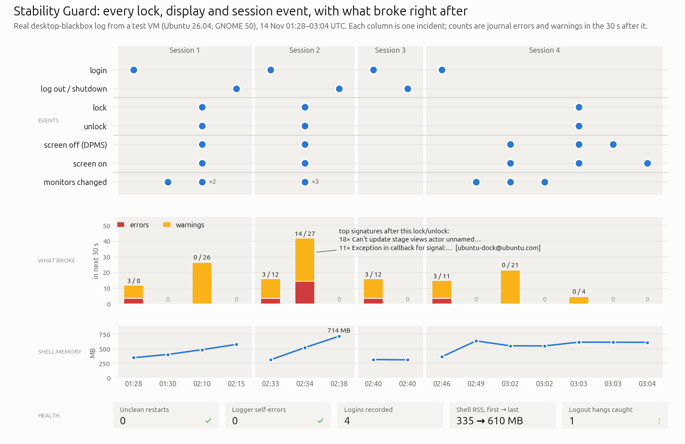
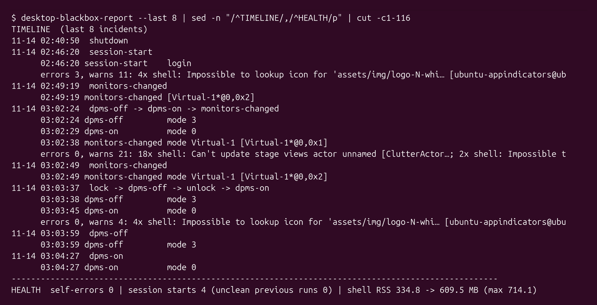

# Stability Guard

Stability Guard is a set of small background tools that keep a record of what happens on your
desktop, so that when something goes wrong (a monitor stays black after docking, extensions vanish
after a logout, the shell restarts) you can see what happened and in what order. It has three parts:

- the **desktop black-box logger**, which records desktop events and the errors that follow them;
- the **logout-hang recorder**, which notices when GNOME Shell had to be force-killed at logout;
- a set of **fixes built into the extensions**, which make them survive situations that used to
  break them.

Everything stays on your computer. Nothing is uploaded.



## Why (vs stock Ubuntu)

On stock Ubuntu the evidence for a desktop glitch is scattered across the system journal, the user
journal and the kernel log, and most of it is gone or buried by the time you notice the problem.
There is no single place that says "the external monitor was unplugged at 14:02, and 3 seconds later
the shell logged these errors". Stock GNOME also gives no explanation when it switches off all your
extensions after a hung logout: they simply look gone at the next login.

Stability Guard fills both gaps: one local event log with a readable report, and a notification when
a logout hang has turned your extensions off.

## How to use

Both services start automatically when you log in. You only need to do something when you want to
look at what was recorded.

### The desktop black-box logger



The logger (`desktop-blackbox`, a user service) listens for these desktop events:

| Event | Recorded as |
| --- | --- |
| Login, or the logger itself restarting (also notes when the previous run ended uncleanly) | `session-start` |
| Screen lock and unlock | `lock`, `unlock` |
| Suspend and resume | `suspend`, `resume` |
| Shutdown started or cancelled | `shutdown`, `shutdown-cancelled` |
| Laptop lid closed or opened | `lid-close`, `lid-open` |
| Displays switched off or on (power saving) | `dpms-off`, `dpms-on` |
| Monitor layout changed (monitor added, removed or mode changed) | `monitors-changed` |
| Kernel display hotplug (dock or cable plugged or unplugged) | `hotplug` |
| GNOME Shell restarted, appeared or went away | `shell-restart`, `shell-appeared`, `shell-gone` |
| All user extensions switched off or back on | `ext-global-disable`, `ext-global-enable` |

Events that happen within a few seconds of each other (for example undock, then lid close, then
suspend) are grouped into one **incident**. Around each incident the logger takes snapshots of the
desktop state (immediately, then after 3 and 15 seconds) and also takes a quiet snapshot every
30 minutes. A snapshot covers the monitor layout as GNOME sees it and as the kernel sees it, the lid,
the lock state, the state of every extension, workspaces, GNOME Shell memory use and system memory
pressure.

At the same time it follows the system journal for errors and warnings from GNOME Shell, Xwayland,
the session and the kernel (especially the display and Thunderbolt/USB-C drivers), and for crash
dumps of desktop components. Errors that arrive within a minute of an event are linked to that
event, and errors are attributed to an extension when the message names one.

From the snapshots it flags **anomalies**, things that look wrong, for example:

- a monitor the kernel reports as connected but GNOME does not use, or the reverse;
- the built-in screen disabled while the lid is open;
- an extension in an error state, not active, or enabled but not installed;
- all user extensions switched off;
- GNOME Shell not answering, or restarted (its process changed);
- a window stuck on every workspace (a "sticky" window);
- high memory pressure.

### Reading the report

Open a terminal and run:

```
desktop-blackbox-report
```

The report covers the last 7 days and has these sections:

- **EVENTS**: each event type, how often it happened, and how often errors, warnings or new
  anomalies followed within 30 seconds, with the most common error messages after it.
- **ANOMALIES**: everything that looked wrong, most recent first, and which events it followed.
- **TIMELINE**: the most recent incidents in order, with the events in each, the errors that
  followed and any new anomaly.
- **HEALTH**: how many times the logger started, how many earlier runs ended uncleanly, and GNOME
  Shell's memory use over the period, followed by the most frequent error messages overall.
- **LOGOUT HANGS**: shown only when the logout-hang recorder found incidents in the period.

Options:

| Option | Meaning | Default |
| --- | --- | --- |
| `--since PERIOD` | How far back to look: a number with `s`, `m`, `h`, `d` or `w` (for example `12h`, `3d`, `2w`), or a date such as `2026-11-01` | `7d` |
| `--last N` | Number of incidents shown in the timeline | `15` |
| `--window SECONDS` | How long after an event errors still count as following it | `30` |
| `--anomalies N` | Maximum number of anomaly rows | `25` |
| `--json` | Machine-readable output instead of the text report | off |
| `--state-dir DIR` | Read a log from another folder (for example a copy from another machine) | `~/.local/state/desktop-blackbox` |
| `-h`, `--help` | Show the option list | |

Examples:

```
# What happened today?
desktop-blackbox-report --since 24h

# The last 5 incidents since this morning, as a short timeline
desktop-blackbox-report --since 2026-11-13 --last 5

# Count errors up to a minute after each event
desktop-blackbox-report --window 60

# A month of data as JSON, saved to a file
desktop-blackbox-report --since 30d --json > ~/blackbox-report.json
```

### The logout-hang recorder

Sometimes GNOME Shell does not quit in time when you log out, and systemd force-kills it. When that
happens, GNOME may conclude that an extension is to blame and switch off **all** user extensions at
your next login.

About 20 seconds after each login, the logout-hang recorder (`shell-logout-hang-log`, a user service)
checks the journal since its last run for such a forced kill. For each one it writes a line to
`~/.local/state/shell-logout-hangs.log` that says when it happened, which apps also hung during the
same logout, and whether the extensions were turned off. Then it shows a notification titled
**"GNOME Shell hung on the last logout"**. If your extensions are currently off, the notification is
marked urgent and includes the command to turn them back on:

```
gsettings set org.gnome.shell disable-user-extensions false
```

You can also turn them back on in the Extensions app. The same incidents appear at the end of
`desktop-blackbox-report`.

To rebuild the list from the whole journal (without a notification), run
`shell-logout-hang-log --all`.

### Fixes built into the extensions

These have no controls of their own. They make the bundled extensions survive situations that used
to break them.

- **Staying on through the lock screen.** Stock GNOME switches extensions off while the screen is
  locked and back on at unlock, which slowly reshuffled workspaces over many unlocks. Workspace
  Manage, Maximize to Own Workspace and DND Hides Critical now stay on while the screen is locked.
- **Safe undocking.** Workspace Manage and Thumbnail Wallpaper no longer act on outdated monitor
  information while a dock or external monitor is being unplugged, and Workspace Manage moves the
  workspaces of a disconnected monitor onto the remaining screen.
- **Shell crash guard.** Works around an open GNOME bug (mutter#5121): clicking just as a popup
  closes while an app switches workspace could crash the whole shell. Maximize to Own Workspace
  works around it.
- **Desktop icons stay put.** After docking, the desktop-icons windows were treated like normal
  windows, moved to other workspaces and hidden, so the icons disappeared. They are now left alone.
- **No windows stuck on every workspace.** Windows that make themselves visible on every workspace
  are reset by the No Sticky Windows extension, and the black-box logger flags any that slip
  through.
- **Emoji picker clipboard limit.** The emoji picker never saves or restores a clipboard larger
  than 64 MB, so a huge clipboard cannot exhaust memory. See [Emoji picker](emoji-picker.md).

### How to report a problem

1. Write down roughly when the problem happened and what you were doing (docking, waking from
   suspend, unlocking, logging in).
2. Run the report for a period that includes it, for example:

   ```
   desktop-blackbox-report --since 2d > ~/stability-report.txt
   ```

3. Open `~/stability-report.txt` and **review it before sharing**. It contains monitor names, app
   and extension names, error messages from the journal and, for windows stuck on every workspace,
   the window's app name and the start of its title. Remove anything you do not want to share.
4. Attach the file to your issue on GitHub, together with your description from step 1.

## Settings

Stability Guard has no settings. Both parts run as user services and can be switched off for your
account if you prefer:

```
systemctl --user disable --now desktop-blackbox.service
systemctl --user disable --now shell-logout-hang-log.service
```

Use `enable --now` to switch them back on.

### Where the logs live

| File | Contents | Size limit |
| --- | --- | --- |
| `~/.local/state/desktop-blackbox/events.jsonl` | Events, snapshots, errors and anomalies, one JSON record per line | Rotated at 20 MB |
| `~/.local/state/desktop-blackbox/events.jsonl.1` | The previous log after rotation (older records beyond it are deleted) | 20 MB |
| `~/.local/state/desktop-blackbox/journal.cursor` | Where the logger stopped reading the journal, so it can catch up after a restart | Tiny |
| `~/.local/state/shell-logout-hangs.log` | One line per logout hang | Newest 1000 lines |

So the black-box log never takes more than about 40 MB. The logger service is also limited to
150 MB of memory and runs at low priority.

### Privacy

All of this stays on your computer. The logger reads local sources only (GNOME and system D-Bus,
the journal, the kernel's display information and udev), writes only to the files above, and
contains no network code. Nothing is sent anywhere unless you attach a report to an issue yourself.

## Troubleshooting

- **The report is empty or says 0 records.** Check that the logger is running:
  `systemctl --user status desktop-blackbox.service`. It starts with your graphical session, so it
  has nothing to show for a session that has just begun.
- **All my extensions are gone after logging in.** Most likely GNOME switched them off after a hung
  logout. Look for the "GNOME Shell hung on the last logout" notification or check
  `~/.local/state/shell-logout-hangs.log`, then turn them back on in the Extensions app or with
  `gsettings set org.gnome.shell disable-user-extensions false`.
- **I want to see more history.** Records older than the two 20 MB files are not kept; use
  `--since` with a longer period to see everything that is still there.
- **I need the raw data.** Use `desktop-blackbox-report --json`, or read the `events.jsonl` files
  directly.

## See also

- [Features inventory](../FEATURES-INVENTORY.md), section "4. Stability Guard"
- [Workspaces](workspaces.md)
- [Notifications](notifications.md)
- [Project README](../../README.md)
