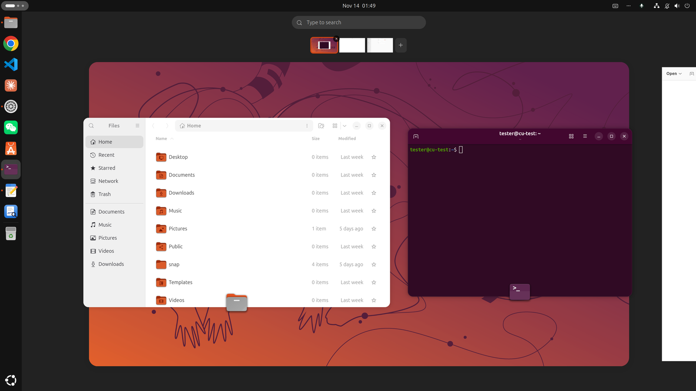
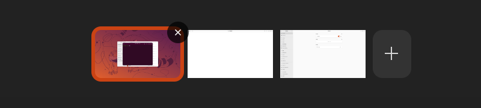
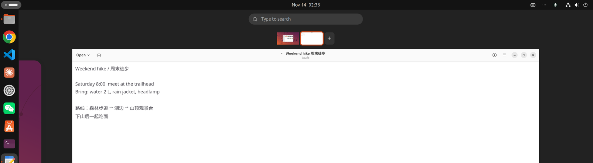
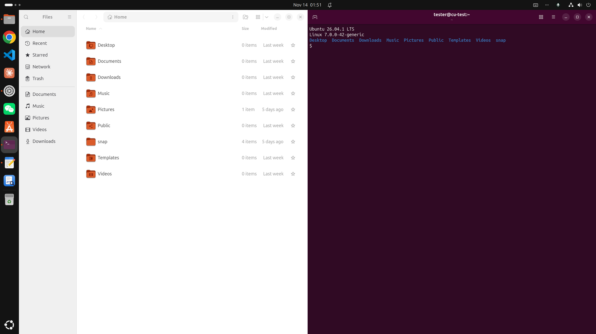

# Windows and workspaces

Stock GNOME gives you dynamic workspaces on the primary monitor only, and leaves window
management at that. This package reworks it along the lines of macOS Mission Control: you manage
workspaces directly in the overview, every monitor has its own workspaces, a maximized window gets
a space of its own, and two windows can share a space side by side in Split View. A handful of
smaller extensions fix everyday annoyances such as title bars hidden under the top bar or windows
that show up on every workspace.

All of these are GNOME Shell extensions and are on by default. You can switch any of them off in
the Extensions app.

- [Workspace Manage](#workspace-manage)
- [Workspace Islands](#workspace-islands)
- [Maximize to Own Workspace](#maximize-to-own-workspace)
- [Split View](#split-view)
- [Dock Pull Window](#dock-pull-window)
- [Title Bar Below Top Bar](#title-bar-below-top-bar)
- [Hide Minimized](#hide-minimized)
- [No Sticky Windows](#no-sticky-windows)
- [Thumbnail Wallpaper](#thumbnail-wallpaper)
- [Raise Browser](#raise-browser)

---

## Workspace Manage

### What's different from stock

- The workspace strip at the top of the overview becomes a place to manage workspaces, not just
  to switch between them.
- Each monitor starts with **one** workspace when you log in, and workspaces you add stay, even
  when empty, for the rest of the session. Stock GNOME adds and removes workspaces on its own.
- The strip is always shown, even with a single workspace.
- It works the same on the primary monitor and on external monitors (whose workspaces come from
  [Workspace Islands](#workspace-islands)), and you can drag a workspace from one monitor to
  another.
- When you unplug an external monitor, each of its workspaces arrives on the laptop screen as a
  workspace of its own, instead of every window piling onto the workspace you are on. Empty
  workspaces from that monitor are not carried over.

### How to use

Open the overview (press `Super` or click Activities) and use the thumbnail strip at the top:

| To | Do this |
| --- | --- |
| Add a workspace | Click **+** at the end of the strip. Drop a window on **+** to give it a new workspace of its own. |
| Remove a workspace | Hover its thumbnail and click **×**. Its windows move to the workspace before it (or the one after it, if it was the first). The last remaining workspace cannot be removed. |
| Reorder workspaces | Drag a thumbnail left or right. The others slide aside to show where it will land. |
| Move a workspace to another monitor | Drag its thumbnail onto the other monitor's strip. A bar shows where it will go; on drop, the workspace and all its windows move there and become that monitor's active workspace. |

A drag that starts on a thumbnail always moves the whole workspace. To move a single window, drag
the window itself from the large view in the middle of the overview, as usual.

Each monitor can have up to 16 workspaces; the **+** button disappears at that limit.

### Settings

None to set. The package turns off GNOME's dynamic workspaces (Settings > Multitasking) because
GNOME would otherwise delete the empty workspaces you add. If you switch dynamic workspaces back
on, the **+** button is hidden.

---

## Workspace Islands

### What's different from stock

Stock GNOME has workspaces on the primary monitor only; windows on an external monitor stay put
when you switch. [Workspace Islands](https://github.com/danielbernalo/gnome-workspace-islands)
gives every external monitor its own, independent set of workspaces, so you can switch the
workspaces on one monitor without touching the others. It is an upstream extension, downloaded at
a pinned version during installation. Workspace Manage, Maximize to Own Workspace, Split View and
Dock Pull Window all build on it to work on external monitors too.

### How to use

Use the workspace strip on each monitor's overview (see [Workspace Manage](#workspace-manage)), or
the keyboard. These shortcuts act on the external monitor that has focus:

| Shortcut | Action |
| --- | --- |
| `Super+Alt+Right` / `Super+Alt+Left` | Next / previous workspace on that monitor |
| `Super+Alt+1` … `Super+Alt+4` | Go to workspace 1–4 on that monitor |
| `Super+Alt+Shift+Right` / `Super+Alt+Shift+Left` | Move the focused window to the next / previous workspace on that monitor |

On the laptop (primary) screen, GNOME's usual workspace shortcuts apply, for example
`Super+Page Up` / `Super+Page Down`.

### Settings

Its preferences (including the shortcuts) are in the Extensions app under Workspace Islands.

---

## Maximize to Own Workspace

### What's different from stock

When you maximize a window or make it full screen, it gets a workspace of its own, much like a
macOS full-screen space. The window itself stays where it is; the other windows that shared the
workspace move to a new workspace placed just before it, so nothing jumps under your eyes. When you
un-maximize or minimize the window, it rejoins the windows it was separated from. Workspaces created
along the way are removed again once they are empty; workspaces you added yourself are never
removed.

A full-screen space holds only its window. A new window that opens on it, or a window you move
onto it, goes to a fresh workspace right after it. This works on external monitors too.

### How to use

Maximize a window as usual: double-click its title bar, click the maximize button, or press
`Super+Up`. Press `Super+Down` (or double-click the title bar again) to restore it and send it back
to its old workspace.

---

## Split View

### What's different from stock

Stock GNOME can tile two windows side by side on a workspace, but has nothing like macOS's "drag a
window onto a full-screen space". Split View, part of Maximize to Own Workspace, lets two windows
share one full-screen space 50/50. The pair counts as a full-screen space: it keeps the workspace
to itself.

### How to use

Start with at least one window in a full-screen space (maximize it, see above). Then, either:

**Drag a window onto the space**

1. Open the overview (`Super`).
2. Drag a window from the large view toward the full-screen space's thumbnail in the strip at the
   top.
3. As you move over the thumbnail, the half under the pointer lights up. Pick the left or right
   half and drop.

The dropped window takes that half, the window already there takes the other half, and you are
switched to that workspace.

**Or drag one full-screen space onto another**

1. Open the overview with two full-screen spaces in the strip.
2. Drag one space's thumbnail onto the middle of the other's (not its outer edges, which reorder
   as usual) until a half lights up, and drop.

The two windows become a pair in the target space, and the dragged space goes away.

Split View works on the primary monitor and, with Workspace Islands running, on external monitors.
If either window cannot fit in half the screen, the drop behaves as a normal drop instead.

**Resizing:** drag the edge where the two windows meet; the other window resizes with it.

**Ending a pair:**

- Close, minimize or maximize one of the windows, or move it to another workspace or monitor: the
  pair ends and the window left behind becomes full screen again.
- Drag one half away by its title bar (more than a short distance), resize it from an outer edge,
  or use a tiling shortcut such as `Super+Down`: the pair ends and both windows stay where they are
  as ordinary windows on a normal workspace. A short title-bar drag just snaps the half back.

---

## Dock Pull Window

### What's different from stock

In stock GNOME, clicking a dock icon whose window is on another workspace switches you to that
workspace. With this extension, an ordinary (not maximized) window comes to the workspace you are
on instead, and a minimized one is restored there. Windows that own a space, that is maximized,
full-screen and Split View windows, keep the stock behaviour and you are switched to them; so do
clicks made while you are in a full-screen space. On an external monitor, the window joins that
monitor's visible workspace.

### How to use

Any of these pull the window to you:

- Click the app's icon in the dock.
- Press `Super+1` … `Super+9` (the dock's shortcuts for its first nine icons).
- Pick a window from the dock icon's window previews, its "All Windows" menu, or its app spread.

Alt+Tab, clicks in the overview and notification clicks are unchanged.

---

## Title Bar Below Top Bar

### What's different from stock

Some apps, notably Chrome and its web apps, can open with their title bar hidden under the GNOME
top bar, so the window can no longer be grabbed and moved. This extension never lets a window's
title bar sit under the top bar: such a window is pushed down just below it. With a monitor placed
above another, a window you drag upward stops at the top bar and only crosses onto the upper
monitor once the pointer itself does.

### How to use

Automatic. Full-screen and maximized windows are left to GNOME.

---

## Hide Minimized

### What's different from stock

Stock GNOME keeps showing minimized windows in the overview and in the Alt+Tab window switcher.
This extension leaves them out of both, as macOS does.

### How to use

Get a minimized window back from the dock: click the app's icon, or use the app spread or window
previews, which still list minimized windows. `Super+Tab` (switch applications) also brings it
back.

---

## No Sticky Windows

### What's different from stock

Some apps mark their own windows "Always on Visible Workspace", which makes them appear on every
workspace and in every overview thumbnail. The Claude desktop app does this, and Chrome and other
Chromium- or Electron-based apps (Edge, VS Code, Cursor, Obsidian, WeChat, Slack, Discord, Chrome
web apps) can too. This extension switches it back off whenever it happens, so each window stays on
one workspace.

Windows on external monitors are not affected; with Workspace Islands they are meant to be on all
of GNOME's workspaces.

### How to use

Automatic. Note that this also undoes "Always on Visible Workspace" if you choose it yourself from
the window menu of one of these apps on the primary monitor.

---

## Thumbnail Wallpaper

### What's different from stock

Stock GNOME draws the workspace thumbnails at the top of the overview on plain grey. This
extension puts your wallpaper behind them, matching the thumbnails on external monitors.

### How to use

Automatic; the change shows the next time you open the overview.

---

## Raise Browser

### What's different from stock

When another app (WeChat, Files and so on) opens a link, Chrome opens it in a new tab, but on
Wayland stock GNOME leaves Chrome behind the window you are in, so the tab appears to go nowhere.
This extension brings Chrome to the front with the new tab, switching workspace or restoring it
from minimized if needed.

### How to use

Automatic. It applies to Google Chrome only. Chrome web apps (such as Outlook or Teams installed
as apps) are not raised, so they keep notifying you instead of taking focus.

---

## Troubleshooting

- **A change has no effect after an update.** On Wayland, a new or updated extension only takes
  effect after you log out and log back in.
- **A feature is missing entirely.** Open the Extensions app and check that the extension is
  switched on. Extensions you turn off stay off, including across updates.
- **Workspaces you added are gone after logging in.** That is by design: every monitor starts
  with one workspace at login.
- **No "+" button in the strip.** Dynamic workspaces are on (Settings > Multitasking), or the
  monitor already has 16 workspaces.
- **Split View or Dock Pull Window does not act on an external monitor.** Both need Workspace
  Islands and Workspace Manage running; without them, external monitors fall back to stock
  behaviour.
- **A window refuses to stay on all workspaces.** See [No Sticky Windows](#no-sticky-windows).

## See also

- [Shortcut Cheatsheet](shortcut-cheatsheet.md): hold `Super` to see these shortcuts on screen
- [Stability Guard](stability-guard.md): the crash guards and logs behind these extensions
- [Features inventory](../FEATURES-INVENTORY.md)
- [Project README](../../README.md)
